# education-platform · 多语言云原生在线教育平台

> **一个三语言（Java 21 / Go 1.25 / Python 3.12）微服务教育 SaaS 平台**：14 个 Java 服务 + 2 个 Go 实时服务 + 1 个 Python AI 平台（9 模块）+ 7 个前端应用 + 7 个公共库，覆盖 **K12 在线教育、职业教育、棋类教育、康养养老** 四大业务板块，按 **4 单元（Cell）异地多活** 架构设计，SDD 契约先行（9 OpenAPI + 8 AsyncAPI），10 条工程铁律治理，**233 个架构决策（D-001 ~ D-233）全程留痕，v7 逐项目群评分 91.8 / A-**（18 个项目单元逐项打分见 `docs/architecture/project-group-scorecard-v7.md`）。


-orange)
-blueviolet)


---

## 目录

- [1. 项目概述](#1-项目概述)
- [2. 系统架构](#2-系统架构)
- [3. 核心设计决策](#3-核心设计决策)
- [4. 关键实现剖析](#4-关键实现剖析)
- [5. 目录结构](#5-目录结构)
- [6. 快速开始](#6-快速开始)
- [7. 测试体系](#7-测试体系)
- [8. 部署](#8-部署)
- [9. 监控运维](#9-监控运维)
- [10. 文档索引](#10-文档索引)
- [11. 项目治理：铁律与决策](#11-项目治理铁律与决策)
- [12. SDD 契约成熟度](#12-sdd-契约成熟度)
- [13. 架构评分卡](#13-架构评分卡)

---

## 1. 项目概述

### 1.1 项目定位

本项目是一个**面向多租户 SaaS 的教育平台参考实现**，完整模拟大厂级全栈工程流程：

```
需求（SRS） → 架构（SAD/ADR） → 契约（SDD：OpenAPI/AsyncAPI） → 实现（三语言微服务）
        → 测试（1300+ Java 用例 / 变异测试 / k6 压测 / E2E） → 部署（K3s + ArgoCD GitOps + 4 单元多活）
        → 度量（架构评分卡 94.5/A） → 治理（10 条铁律 + 217 项决策留痕）
```

**四大业务板块 × 八大服务域：**

| 业务板块 | 服务域 | 承载服务 | 亮点 |
|---|---|---|---|
| K12 / 职业教育 | 核心教学 | `core-business` | 课程/用户/报名、领域事件驱动、虚拟线程 |
| K12 / 职业教育 | 智能批改 | `grading-service` + `grading-api` | Judge0 沙箱执行、AI 查重、**Disruptor 三级批改流水线** |
| 全板块 | 交易履约 | `order-platform` + `payment-platform` | **Seata Saga 补偿事务**、幂等键、中台化独立抽取 |
| 全板块 | 知识库 | `knowledge-bff` / `knowledge-service` / `retrieval-service` / `agent-service` / `mcp-server` | 文档解析→向量化→检索管道、Milvus 语义检索、**MCP + A2A Agent 架构** |
| 全板块 | AI 平台 | `ai-platform`（Python，9 模块） | **四层成本栈**（语义缓存→RouteLLM→级联→降级）、RAG、Reflexion |
| 全板块 | SaaS 控制平面 | `tenant-service` | 多租户隔离 + **Metering / Billing / ApiKey** 计量计费 |
| 棋类教育 | 棋牌对弈 | `boardgame-service` | **象棋规则引擎** + Elo 天梯 + 走子流水线 |
| 康养养老 | 康养监护 | `senior-care` | IoT 健康遥测、Disruptor 窗口聚合异常检测 |
| 全板块 | 实时互动 | `ws-gateway` / `live-go`（Go） | **纯标准库 RFC6455 WebSocket 网关**、跨 Pod 广播、直播推拉流 |
| 全板块 | 数据平台 | `data-platform` | 血缘/剖析/漂移检测/NL Query、CDC 摄入流水线 |

### 1.2 关键数字

```
架构评分          v5 93.5 / 100（A，制品完备度标尺）→ v6 91.0（A-，实战有效性标尺）→ v7 91.8（A-，逐项目群矩阵 + 大厂标准对齐重构，见 §13）
架构决策          233 项（D-001 ~ D-233，decisions.jsonl 全程留痕；D-233 = 风控滑动窗口 + 幂等重放 + 缓存热点闭环）
后端服务          17 个：Java 14 + Go 2 + Python 1（AI 平台内含 9 模块）
公共库            7 个：Java 5（ep-web-common / ep-disruptor / ep-cache / ep-data / ep-memory-java）
                          + Go 1（ep-common-go）+ Python 1（ep-common-python）
前端应用          7 个（Web 3 + H5 2 + 小程序 2），pnpm monorepo + @ep/ scope
SDD 契约          17 份（OpenAPI 9 + AsyncAPI 8），Spectral lint 门禁
Java 测试         ≈ 1730 用例 0 失败（mvn -o test 全量实证）+ 21 个 IT 类
Python 测试       279 用例（pytest）
Go 测试           全覆盖（-race 跑法，含 WS 限频 3 项）
k6 压测           14 套脚本（1K → 百万级在线模拟、秒杀尖峰、跨语言对比、SDD 契约验证）
前端测试          89 用例本轮实证（7/7 app 构建通过；历史累计 223；12/12 typecheck 全绿）
CI Workflows      14 条（测试矩阵/覆盖率/变异测试/AOT 门禁/铁律扫描/三重安全扫描）
多活单元          4 个（cell-bj / cell-hz / cell-sz / cell-sg）
真实集群          applications-cluster 双节点部署实证（Wave-1 六镜像双节点就绪，runbook 11 踩坑）
风控效能          窗口边界放行 2×→1.0×；XFF 伪造绕过→不可行；崩溃重试等待 24h→≤5min；Redis 故障自愈 ≤30s（D-233）
```

### 1.3 技术栈总表

| 层 | 选型 | 说明 |
|---|---|---|
| **Java 运行时** | JDK 21，虚拟线程全局开启 | IO 密集服务最优并发模型；配套 `DbConnectionSemaphore` 信号量防止虚拟线程打满连接池 |
| Java 框架 | Spring Boot 4.0.x（根 BOM 统一版本） | 全 14 服务版本对齐；GraalVM AOT 元数据门禁 |
| Java RPC | Apache Dubbo 3.3（Triple 协议） | IDL 友好、跨语言互通 |
| 分布式事务 | Seata 2.0（**Saga 模式**） | 订单-支付-库存长事务补偿（§4.1） |
| 高并发内核 | **LMAX Disruptor 4.0** | 无锁 RingBuffer 多级流水线，公共库 `ep-disruptor`（§3.1） |
| 数据访问 | **ep-data**（可插拔 + 读写分离） | TiDB / CockroachDB / MySQL / H2 一键切换（§3.2） |
| 缓存 | **ep-cache**：L1 Caffeine + L2 Redis + **Pulsar 三语言失效广播** | Java/Go/Python 缓存一致性协议统一（§3.5） |
| 韧性 | Resilience4j（限流/断路） | 多服务接入 |
| **Go 运行时** | Go 1.25 | goroutine per connection + channel 泵模型 |
| Go WebSocket | **纯标准库 RFC6455 实现** | ws-gateway 零三方 WS 依赖；生产 fail-closed 鉴权 |
| **Python 运行时** | Python 3.12 + asyncio | Litestar（非 FastAPI）+ Granian 服务器 |
| LLM 编排 | LangGraph + LangChain-Core + mem0ai | Agent 状态机、四级记忆体系 |
| 消息 | Apache Pulsar 3.x | 领域事件总线 + 缓存失效 + WS 跨 Pod 广播 |
| 关系库 | **TiDB（主）+ CockroachDB（海外单元）** | 双库架构经 PoC 评审（D-194 / D-203） |
| 向量库 | Milvus（Java SDK 2.5 / pymilvus） | 语义检索 + RAG |
| 图库 | NebulaGraph → **TiDB CTE 兜底** | 知识图谱/血缘图，降级路径内置 |
| 前端 | React 19 + AntD 5 + TanStack Query + Vite | pnpm monorepo + Turborepo |
| 跨端 | Taro 4（微信小程序 + H5 双端产出） | ui-kit 平台适配层解耦 |
| 可观测 | OpenTelemetry + Micrometer | traceparent 全链路透传 |
| 构建 | Maven / **JIB 免 Dockerfile 镜像** / pnpm + turbo | 镜像构建确定性 |
| GitOps | **ArgoCD app-of-apps** + Kustomize + Karmada | 声明式多集群同步 |

---

## 2. 系统架构

### 2.1 总体架构（客户端 → 网关 → BFF → 服务 → 中间件）

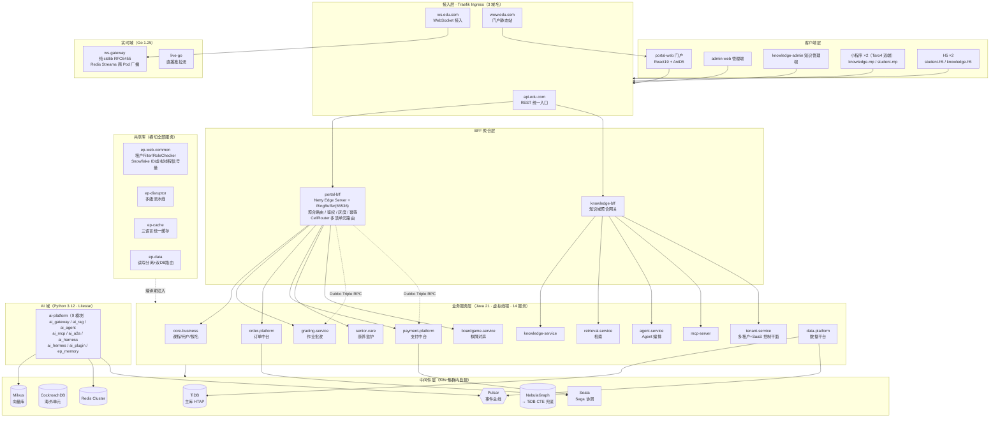

**分层要点：**

- **接入层**：Traefik Ingress 暴露 3 个域名 —— `api.edu.com`（REST 统一入口）、`www.edu.com`（门户静态站）、`ws.edu.com`（WebSocket 长连接）
- **BFF 层**：`portal-bff` 是自研 Netty 边缘服务器（65536 RingBuffer 削峰），内置 **CellRouter** 多活单元路由（Hash 路由 + WriteHoldRegistry 写保持，D-083/D-090）；`knowledge-bff` 聚合知识域
- **服务层**：Java 业务服务全部运行于虚拟线程；跨服务同步调用走 Dubbo Triple，异步走 Pulsar 领域事件
- **中间件层**：生产中间件一律 K8s 集群内部署（FQDN 访问），禁止 localhost（铁律 1 类约束）

### 2.2 服务拓扑与领域划分

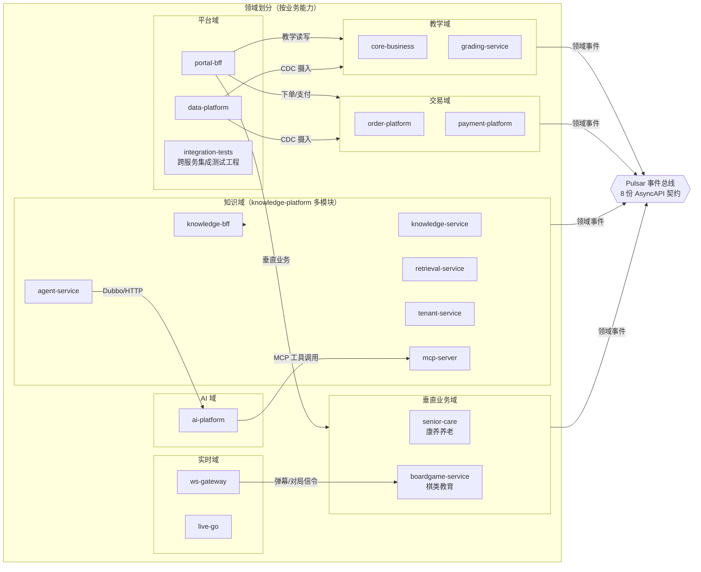

**服务清单（17 个后端服务 + 7 个公共库）：**

| # | 服务 | 语言 | 领域 | 职责 |
|---|---|---|---|---|
| 1 | `core-business` | Java | 教学 | 课程/用户/报名，领域事件 + Disruptor 副作用流水线 |
| 2 | `grading-service` | Java | 教学 | 作业批改，Judge0 沙箱 + 三级流水线 |
| 3 | `order-platform` | Java | 交易 | 订单中台（api/service 多模块），Seata Saga |
| 4 | `payment-platform` | Java | 交易 | 支付中台（api/service 多模块），回调幂等流水线 |
| 5 | `portal-bff` | Java | 平台 | 统一 BFF：Netty Edge + CellRouter + 灰度 |
| 6 | `knowledge-bff` | Java | 知识 | 知识域聚合网关 |
| 7 | `knowledge-service` | Java | 知识 | 文档/语料管理（MyBatis-Plus） |
| 8 | `retrieval-service` | Java | 知识 | 检索服务（Milvus） |
| 9 | `agent-service` | Java | 知识 | Agent 编排（Java 侧） |
| 10 | `tenant-service` | Java | SaaS | 多租户 + Metering/Billing/ApiKey 控制平面 |
| 11 | `mcp-server` | Java | 知识 | MCP 工具服务器 |
| 12 | `data-platform` | Java | 数据 | 血缘/剖析/漂移检测/NL Query/AIOps |
| 13 | `senior-care` | Java | 康养 | IoT 遥测异常检测告警 |
| 14 | `boardgame-service` | Java | 棋类 | 象棋规则引擎 + Elo 天梯 + 对局回放 |
| 15 | `ws-gateway` | Go | 实时 | 纯 stdlib RFC6455 WebSocket 网关 |
| 16 | `live-go` | Go | 实时 | 直播推拉流 / 弹幕批量管道 |
| 17 | `ai-platform` | Python | AI | 9 模块：gateway/rag/agent/mcp/a2a/harness/hermes/plugin/memory |

| 公共库 | 语言 | 提供能力 |
|---|---|---|
| `ep-web-common` | Java | TenantContextFilter 租户过滤器、RoleChecker、**Snowflake ID（时钟回拨保护）**、DbConnectionSemaphore 虚拟线程信号量、全局异常/Actuator 安全 |
| `ep-disruptor` | Java | LMAX Disruptor 单级 Worker + 任意级 Pipeline + Registry 生命周期（§3.1） |
| `ep-cache` | Java | L1 Caffeine + L2 Redis + Pulsar 失效广播（三语言协议对齐） |
| `ep-data` | Java | 读写分离路由 + TiDB/CockroachDB 双 provider（§3.2） |
| `ep-memory-java` | Java | 四级记忆体系 Java 侧（L0~L3） |
| `ep-common-go` | Go | 缓存失效协议等 Go 侧公共件 |
| `ep-common-python` | Python | 缓存失效协议等 Python 侧公共件 |

#### 2.2.1 服务端口与框架清单（数字化）

| # | 服务 | 端口 | 语言 | 框架 | 领域 | 职责 | 限界上下文 |
|---|---|---|---|---|---|---|---|
| 1 | `portal-bff` | 8090 | Java | Spring Boot 4 + Netty | 平台 | 统一 BFF / CellRouter / 灰度 | Platform BFF |
| 2 | `core-business` | 8083 | Java | Spring Boot 4 + JPA | 教学 | 课程/用户/报名 + 领域事件 | Teaching |
| 3 | `grading-service` | 8085 | Java | Spring Boot 4 + Dubbo | 教学 | 作业批改 + Judge0 沙箱 | Grading |
| 4 | `order-platform` | 8084 | Java | Spring Boot 4 + Seata | 交易 | 订单中台 + Saga | Order |
| 5 | `payment-platform` | 8087 | Java | Spring Boot 4 + JPA | 交易 | 支付中台 + 回调幂等 | Payment |
| 6 | `tenant-service` | 8074 | Java | Spring Boot 4 + MyBatis | SaaS | 多租户 + Metering/Billing | Tenant |
| 7 | `knowledge-bff` | 8070 | Java | Spring Boot 4 | 知识 | 知识域聚合网关 | Knowledge BFF |
| 8 | `knowledge-service` | 8071 | Java | Spring Boot 4 + MyBatis-Plus | 知识 | 文档/语料管理 | Knowledge |
| 9 | `retrieval-service` | 8072 | Java | Spring Boot 4 + Milvus | 知识 | 向量检索 + FGAC | Retrieval |
| 10 | `agent-service` | 8073 | Java | Spring Boot 4 | 知识 | Agent 编排（Java 侧） | Agent |
| 11 | `mcp-server` | 8090 | Java | Spring Boot 4 | 知识 | MCP 工具服务器 | MCP |
| 12 | `data-platform` | 8082 | Java | Spring Boot 4 + Flink | 数据 | 血缘/剖析/漂移/NL Query | Data |
| 13 | `senior-care` | 8088 | Java | Spring Boot 4 | 康养 | IoT 遥测异常检测 | Senior Care |
| 14 | `boardgame-service` | 8089 | Java | Spring Boot 4 + proto | 棋类 | 象棋引擎 + Elo 天梯 | Boardgame |
| 15 | `ws-gateway` | 8081 | Go | 纯 stdlib + Redis | 实时 | RFC6455 WebSocket 网关 | Realtime WS |
| 16 | `live-go` | — | Go | stdlib + LiveKit SDK | 实时 | 直播推拉流 + 弹幕 | Realtime Live |
| 17 | `ai-platform` | 8086 | Python | Litestar + LangGraph | AI | 9 模块 AI 平台 | AI |

#### 2.2.2 技术栈分层清单（表格化）

| 层 | 技术 | 版本 | 用途 | 状态 |
|---|---|---|---|---|
| Java 运行时 | JDK | 21 | 虚拟线程全局开启 | ✅ 生产就绪 |
| Java 框架 | Spring Boot | 4.0.x | 根 BOM 统一版本 | ✅ 生产就绪 |
| Java RPC | Apache Dubbo | 3.3 | Triple 协议 + Protobuf | ✅ |
| 分布式事务 | Seata | 2.0 | Saga 状态机编排 | ✅ |
| 高并发内核 | LMAX Disruptor | 4.0 | 无锁 RingBuffer 多级流水线 | ✅ |
| Go 运行时 | Go | 1.25 | goroutine per connection | ✅ |
| Go WebSocket | 纯标准库 | RFC6455 | 零三方 WS 依赖 | ✅ |
| Python 运行时 | Python | 3.12 | asyncio + Litestar | ✅ |
| LLM 编排 | LangGraph | latest | Agent 状态机 + Reflexion | ✅ |
| 消息 | Apache Pulsar | 3.x | 领域事件总线 + 缓存失效广播 | ✅ |
| 关系库（国内） | TiDB | latest | HTAP 主库 + TiFlash 列存 | ✅ |
| 关系库（海外） | CockroachDB | latest | `REGIONAL BY ROW` 多区域 | 📦 PoC 就绪 |
| 向量库 | Milvus | 2.5 | 语义检索 + RAG | ✅ |
| 图库 | NebulaGraph | latest | 知识图谱/血缘（TiDB CTE 兜底） | ⚠️ 降级路径内置 |
| 前端 | React | 19 | AntD 5 + TanStack Query | ✅ |
| 跨端 | Taro | 4.0.9 | 微信小程序 + H5 双端 | ✅ |
| 构建 | Maven / JIB | — | 免 Dockerfile 镜像 | ✅ |
| GitOps | ArgoCD | — | app-of-apps + Karmada | 📦 制品就绪 |
| 可观测 | OpenTelemetry | — | traceparent 全链路透传 | ✅ |

### 2.3 多活单元（Cell）架构

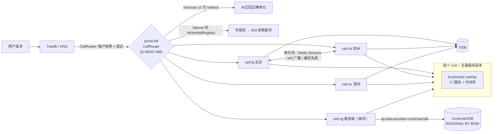

- **4 个多活单元**（bj / hz / sz / sg），Karmada propagation 跨集群调度，每单元独立 Kustomize overlay + TopologySpread
- **CellRouter**：Hash 路由 + misroute 纠正（≤3 次 redirect，>3 次 reject）+ **WriteHoldRegistry**（failover 期间写保持，防跨单元脏写）；路由状态外化 Redis（铁律 1）
- **cell-sg 海外单元**走 CockroachDB（`REGIONAL BY ROW` 多区域表），国内走 TiDB —— 由 `ep-data` 按 `ep.data.provider` 属性一键切换（§3.2，D-194/D-203）

### 2.4 请求链路剖面：一次「提交作业 → AI 批改」

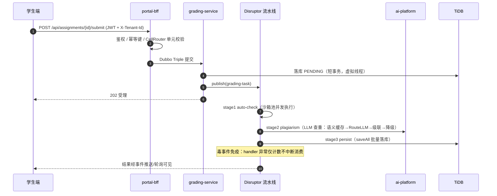

这条链路同时体现了四个核心设计：BFF 边缘削峰（RingBuffer 65536）、批改流水线（Disruptor 三级）、AI 成本栈（四层）、以及「重 IO 移出 DB 事务」原则。

---

## 3. 核心设计决策

> 所有重大决策均按**铁律 8**完成 ≥3 方案对比，登记于 `decisions.jsonl`（D-001 ~ D-217），关键决策另有 ADR 文档（`docs/adr/`）。

### 3.0 DDD 限界上下文映射（图形化）

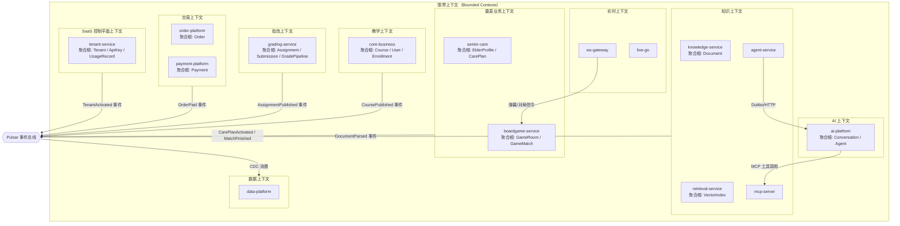

### 3.0.1 限界上下文汇总表（表格化）

| 限界上下文 | 聚合根 | 领域事件数 | 服务 | Pulsar Topic |
|---|---|---|---|---|
| Teaching | Course / User / Enrollment | 3 | core-business | `ep-business-domain-events` |
| Grading | Assignment / Submission / GradePipeline | 2 | grading-service | `ep-business-domain-events` |
| Order | Order | 2 | order-platform | `order-service-events` |
| Payment | Payment | 0 | payment-platform | — |
| Knowledge | Document / VectorIndex | 2 | knowledge-service + retrieval + agent + mcp | `knowledge-events` |
| SaaS | Tenant / ApiKey / UsageRecord | 3 | tenant-service | `tenant-events` |
| Senior Care | ElderProfile / CarePlan | 5 | senior-care | `senior-care-events` |
| Boardgame | GameRoom / GameMatch | 3 | boardgame-service | `boardgame-service-events` |
| Data | — | 0（消费者） | data-platform | `cdc/*` ×3 |
| Realtime | — | 0 | ws-gateway + live-go | Redis Streams |
| AI | Conversation / Agent | 0（内部） | ai-platform | 内部 Hermes topic |

### 3.0.2 领域事件流（图形化）

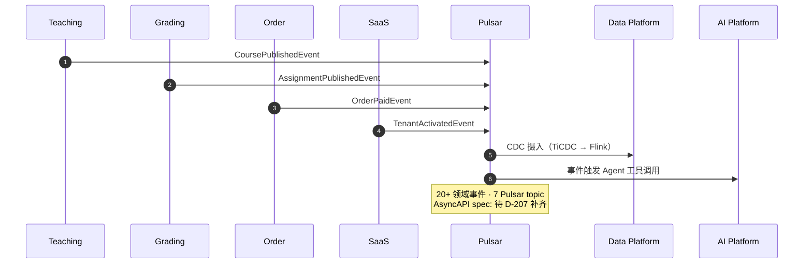

### 3.0.3 多级缓存架构（图形化）

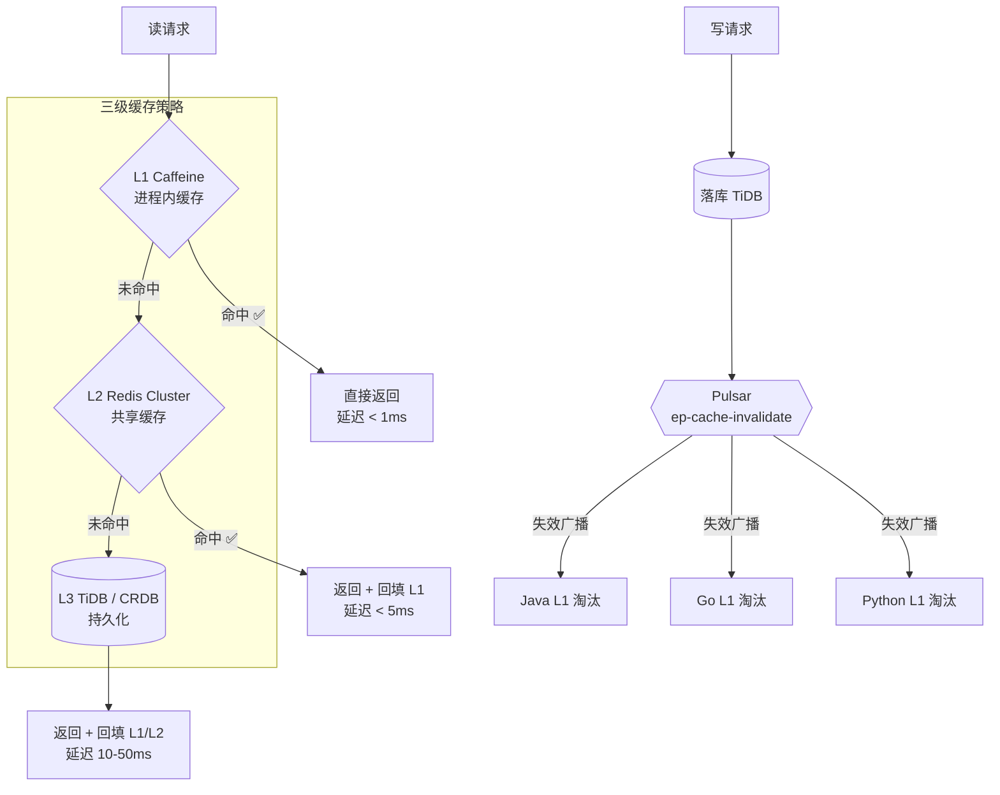

### 3.0.4 缓存命中率目标（表格化，v7 闭环增强）

| 缓存层 | 策略 | 目标命中率 | TTL | 失效机制 | v7 增量 |
|---|---|---|---|---|---|
| L1 Caffeine | 进程内 LRU | ≥ 60% | 5-10 min | Pulsar 广播失效 | 热点探测供容量调参 |
| L2 Redis Cluster | 共享 Cache-Aside | ≥ 85% | 30-60 min | TTL + 主动失效 | — |
| L3 DB | 兜底持久化 | — | — | 写入即最新 | — |
| 空值哨兵 | 防穿透 | — | 60s | `__EP_CACHE_EMPTY__` | — |
| **综合（L1+L2）** | 两级协同 | **≥ 99%（SLO）** | — | — | ✅ `ep_cache_composite_hit_rate` 指标 + <99% WARN 告警（样本≥1000） |
| **热点 key** | 探测→观测→调参 | 晋升 0 次/窗为健康 | 60s 滑窗 | — | ✅ `HotspotDetector`：回源 ≥5 次/窗 → `ep_cache_hotspot_promoted_total` 告警 |

> **v7 命中率提升闭环**：L2 miss → loader fall-through 逐 key 滑窗计数（探测）→ Micrometer 指标 + 周期日志（观测）→ L1 容量/TTL 证据化调参（优化）。探测器刻意不做运行时自动 pin——有界 L1 中 pin 热点会饿死冷 key、再制造淘汰风暴，2025 行业实践是"探测供容量规划"。剩余提升手段：布隆过滤器（P2，空值哨兵已够用）、Redis 7 client-side caching（P3）。

### 3.1 LMAX Disruptor 多级流水线（全服务共用的高并发内核）

**这是本项目最有辨识度的并发设计。** 公共库 [`services/ep-disruptor`](services/ep-disruptor) 提供两类原语：

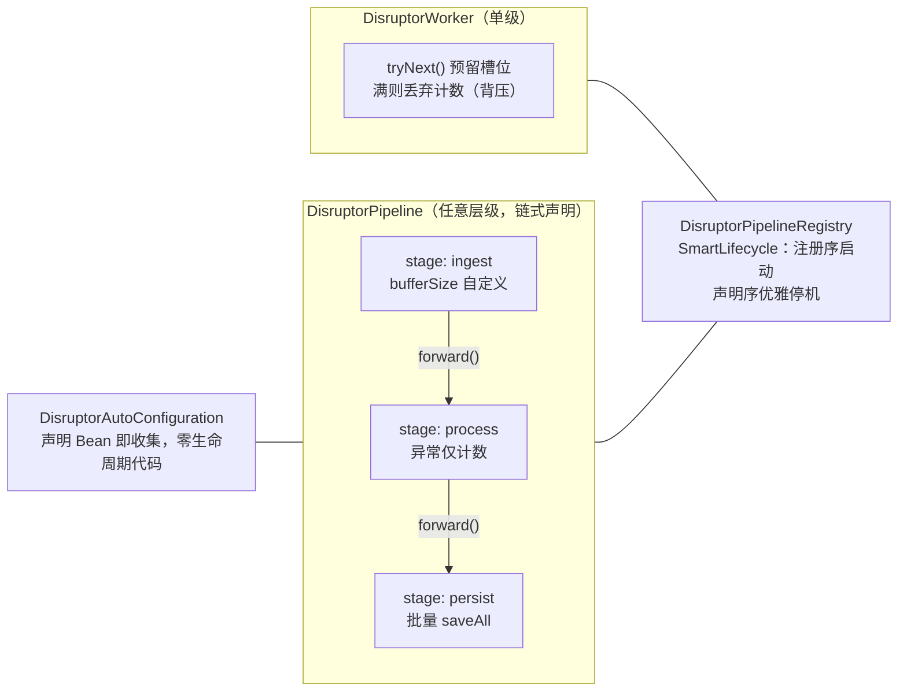

**工程化加固（全部有测试锁定）：**

| 特性 | 实现 | 为什么重要 |
|---|---|---|
| 自定义层级数 | `pipeline.stage(...)` 链式声明 N 级，`forward()` 自动路由 | 各服务按负载形态定制 1~N 级 |
| **毒事件免疫** | 内置 ExceptionHandler：handler 抛异常 → log + `failedCount()` 计数 → 消费线程不退出 | 默认 FatalExceptionHandler 会永久毒化 RingBuffer |
| 槽位不毒化 | translator 抛异常仍 publish 保留序列 | 杜绝「预留不发布」死槽 |
| 优雅停机 | pipeline 内**声明序** shutdown（上游先 drain） | 停机不丢在途事件 |
| 即插即用 | 服务声明 `DisruptorPipeline` Bean 即被自动收集 | 零生命周期模板代码 |

**典型服务流水线分配：**

| 服务 | 流水线 | 解决的问题 |
|---|---|---|
| `grading-service` | `grading-task → auto-check → persist` | 把 10s 级沙箱执行 + Dubbo 查重挪出 DB 事务 |
| `payment-platform` | `callback → verify(SETNX 幂等) → settle` | 渠道回调高频削峰 |
| `order-platform` | `order-write → event-publish` | 事务内逐条领域事件 → 批量发布（outbox 化） |
| `boardgame-service` | `move → rating-update → replay-persist`（BUSY_SPIN） | 走子高频写路径脱离逐条落库 |
| `senior-care` | `sample → anomaly-detect → alert-persist` | IoT 遥测窗口聚合批量告警 |
| `core-business` | `course-cmd → side-effects` | 课程发布事件 + 缓存失效异步化 |
| `knowledge-service` | `upload → parse → vectorize` | 文档解析 → 批量 embedding |
| `data-platform` | `cdc-ingest → normalize → batch-writer`（65536） | CDC 摄入批量落库 + Pulsar 降级 |
| `portal-bff` | `gateway-ingress`（65536） | Netty 边缘写路径削峰 |

### 3.2 双数据库架构：TiDB 主库 + CockroachDB 海外（ep-data）

公共库 [`services/ep-data`](services/ep-data) 让**每个服务自由选择存储 provider 并自动获得读写分离**，一个属性切换：

```yaml
ep.data:
  enabled: true
  provider: cockroachdb   # tidb | cockroachdb | mysql | h2 —— 服务级自由选择
  read-replicas: true
  follower-reads: true    # CRDB 专属：读池自动 SET default_transaction_use_followers
  write: { host: crdb:26257, database: ep_business, maximum-pool-size: 10 }
  read:  { host: crdb-ro:26257, database: ep_business, maximum-pool-size: 20 }
```

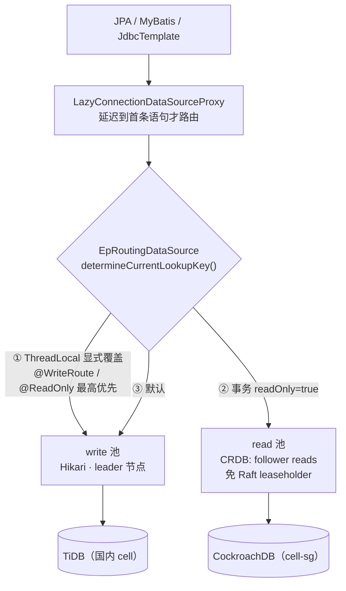

**设计要点：**

- **三级路由决策链**：显式覆盖 > 事务只读标志 > 写库 —— `@WriteRoute` 解决「写后读一致性」（lagging replica 上读不到自己刚写的）
- CRDB 读池连接级 `SET default_transaction_use_followers = on`（stale follower reads，只读事务专用）+ `ApplicationName` 打通 CRDB 控制台可观测
- H2 / 无副本 provider 自动把 READ 折叠到写池（同一 Bean 图，零调用方特判）—— 本地单机测试与生产双库共用一套代码路径
- **双库选型经 PoC 评审**：D-194（CockroachDB PoC 结果）+ D-203（CRDB vs TiDB 替换评估），另有操作手册 `docs/architecture/crdb-dual-db-guide.md`

#### 数据存储清单与读写分离（表格化 + 图形化）

| 数据存储 | 类型 | 用途 | 规模策略 | 状态 |
|---|---|---|---|---|
| TiDB（国内） | 关系型 HTAP | 主库：业务事务 + TiFlash 列存 | PD3 + TiKV3 + TiDB2 + TiFlash2 | ✅ |
| CockroachDB（海外） | 关系型分布式 | `REGIONAL BY ROW` 多区域 | cell-sg 海外单元 | 📦 PoC |
| Redis Cluster | KV 缓存 | L2 共享缓存 + 会话状态 + WS 广播 | 分片集群 | ✅ |
| Milvus | 向量库 | 语义检索 + RAG embedding | 集群部署 | ✅ |
| NebulaGraph | 图库 | 知识图谱/血缘图 | TiDB CTE 递归兜底 | ⚠️ 降级内置 |
| Pulsar | 消息队列 | 领域事件 + 缓存失效 + CDC | 3 broker | ✅ |

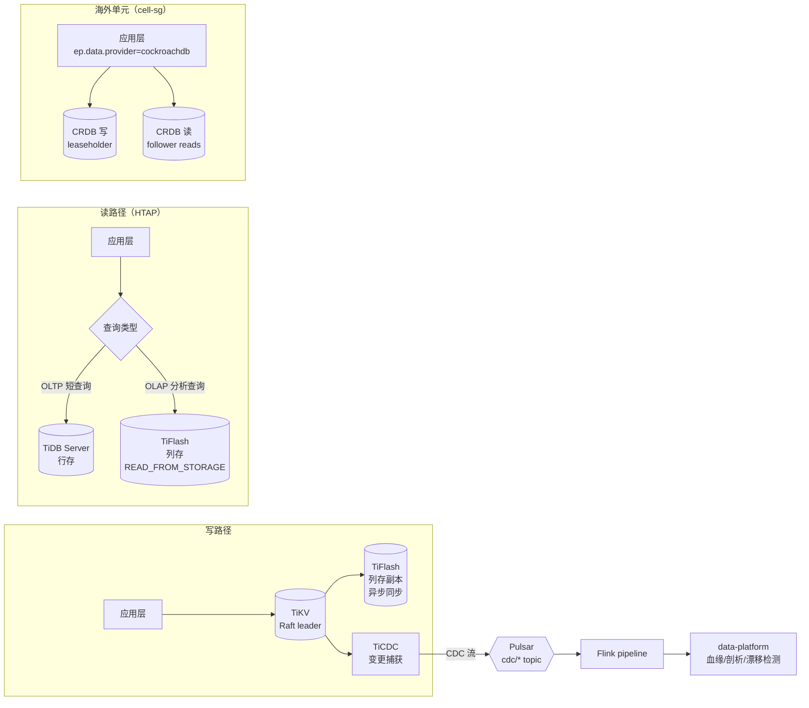

> **读写分离诚实评估（D-201）**：当前未采用 CQRS，读优化依赖 `@Transactional(readOnly=true)` + ep-cache 多级缓存。TiFlash 基础设施就绪（2 副本）但应用层零 `READ_FROM_STORAGE(TIFLASH)` hint，`ep-rw-java` 模块已 DEPRECATED 待用。详见 `docs/architecture/architecture-scorecard.md` 维度 2。

### 3.3 AI 平台四层成本栈（Python）

`ai-platform` 的 LLM 调用统一经过四层成本治理，自上而下逐层兜底：

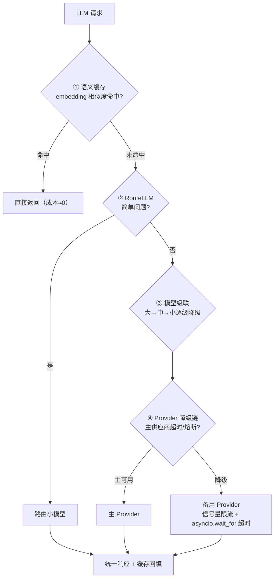

配套治理：

- **LLM 并发治理**：全局 + 每 Provider `asyncio.Semaphore`；同步 Redis/LLM 调用全部 `asyncio.to_thread` 化，事件循环零阻塞
- **四级记忆体系**（`ep-memory`，Java/Python 双语言实现）：L0 即时 → L1 工作记忆 → L2 情景 → L3 语义，Mem0 集成
- **Mock 模式铁律**：`LLM_MODE=mock`（默认）返回确定性响应，CI 不依赖外部 API
- **Agent 架构**：MCP（工具调用）+ A2A（Agent 间协作）+ LangGraph 状态机 + Reflexion 自我反思循环

### 3.4 多租户与 SaaS 控制平面

| 能力 | 实现 | 位置 |
|---|---|---|
| 租户上下文 | `TenantContextFilter` 解析 `X-Tenant-Id` → ThreadLocal 透传 | `ep-web-common` |
| SQL 隔离 | MyBatis TenantLine 拦截器自动追加租户条件 + Row-Level 隔离测试 | 各服务 |
| 计量 Metering | `UsageRecord` 用量采集 → 计量服务 | `tenant-service` |
| 计费 Billing | `BillingInvoice` 账单生成 | `tenant-service` |
| API Key | `ApiKey` 实体 + 校验（租户级开放能力） | `tenant-service` |
| 单元路由 | 租户哈希 → Cell 映射（多活） | portal-bff CellRouter |

设计动机与迁移路径见 `docs/architecture/saas-multi-tenant-transformation.md`（D-198 租户上下文下沉公共库）。

### 3.5 三语言缓存一致性协议（ep-cache）

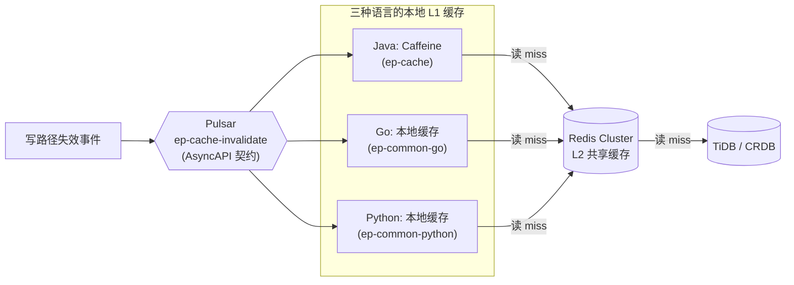

- 失效广播协议在 `docs/contracts/asyncapi/ep-cache-invalidate.yaml` 有正式契约，三种语言实现互验（契约测试）
- L1（进程内）+ L2（Redis）两级；写路径先落库再广播失效，读路径 L1 → L2 → DB

### 3.6 其他技术亮点速览

| 领域 | 设计 | 关键位置 |
|---|---|---|
| BFF 边缘 | Netty Edge Server + 65536 RingBuffer 入队 + 批量转发器（异步 sendAsync + 虚拟线程池 + 信号量） | `services/portal-bff` |
| WebSocket | Go 纯标准库 RFC6455（帧重组 + 心跳 deadline）；跨 Pod 广播经 Redis Streams 消费组（at-least-once）；生产 fail-closed（无 JWT 公钥拒启） | `services/ws-gateway` |
| ID 生成 | Snowflake ID + **时钟回拨保护**（AtomicSnowflakeIdGenerator） | `ep-web-common` |
| 棋类引擎 | 象棋规则引擎（走子合法性/将军判定）+ Elo 天梯 + Stockfish sidecar | `services/boardgame-service` |
| 图谱 | NebulaGraph 主路径 + TiDB CTE 递归查询兜底（图库故障不中断血缘/图谱能力） | `data-platform` / `retrieval-service` |
| 安全 | JWT RS256 双密钥、Actuator Basic 认证、Semgrep + Trivy + Aikido 三重扫描 | `.github/workflows/` |
| AOT | 面向 GraalVM Native Image：禁反射/运行时资源加载，native-ready 脚本门禁 | `scripts/check-native-ready.sh` |

### 3.7 安全纵深防御（图形化 + 表格化）

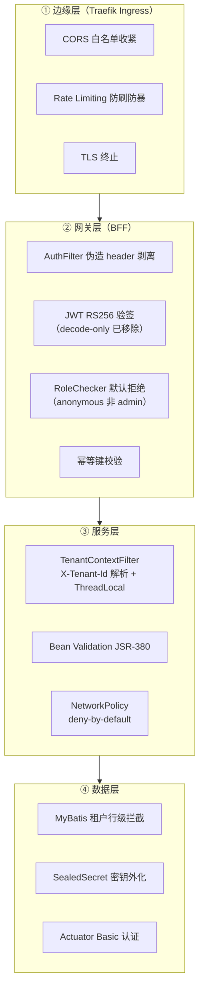

#### 安全风险控制矩阵（表格化）

| 风险类型 | 防护机制 | 实现状态 | 证据 |
|---|---|---|---|
| 伪造 header 注入 | BFF `AuthFilter` 剥离 X-User-Id/X-Role | ✅ | `portal-bff/AuthFilter.java` |
| JWT 篡改 | RS256 验签 + SealedSecret 三层加载 | ✅ | D-117 |
| 越权访问 | RoleChecker 默认 anonymous（非 admin） | ✅ | `ep-web-common/RoleChecker` |
| 跨租户数据泄露 | TenantContextFilter + MyBatis 行级拦截 | ✅（8 服务） | D-198 |
| Actuator 端点暴露 | 强制 Basic 认证 | ✅ | D-154 |
| WebSocket 未授权 | fail-closed（无 JWT 公钥拒启） | ✅ | `ws-gateway/failclosed.go` |
| 非法入参 | Bean Validation JSR-380 全栈 | ✅ | D-154 |
| 流量暴刷 | RiskControlFilter IP+用户双维**滑动窗口**（任意 trailing 窗口精确计数，边界突刺消除）+ XFF 可信代理链（`ep.risk.trusted-proxies`，默认 0 防伪造）+ Redis 故障 30s 半开自愈 + Resilience4j 注解 | ✅ | D-223 + **D-233（v7）** |
| 金额篡改（0.01元购课） | CoursePricingPort 服务端定价复核，fail-closed 拒单 | ✅ | D-218 |
| 水平越权（IDOR 遍历他人订单/答卷） | OrderDubbo/Submission Controller 归属校验（本人或 ADMIN） | ✅ | D-218 |
| 重复支付 | Redis SETNX + DB UNIQUE 双保险幂等 + **重复请求响应重放**（Stripe 标准：2xx 缓存 24h 原样重放；PENDING 409+Retry-After；处理超时 5min 防崩溃僵尸；Lua CAS 原子落状态） | ✅ | D-155/D-221 + **D-233（v7）** |
| 登录撞库 | LoginAttemptLimiter 5次/15分钟锁定（Redis+内存降级） | ✅ | D-219 |
| WS 帧洪水/消息轰炸 | 64KB 帧上限 + 每连接 token bucket 10msg/s | ✅ | D-220 |
| 全表爬取（size=10^6） | 分页 size 上限 100 | ✅ | D-218 |
| 管理操作无留痕 | AuditLogAspect（退款/冻结/发布课程 → AUDIT logger JSON） | ✅ | D-223 |
| 事件丢失（双写间隙） | Transactional Outbox（ep_outbox 同事务 + Relay 重试） | ✅ | D-217 |
| 内部服务直连 | NetworkPolicy deny-by-default | ✅ | D-133 |
| 静态安全漏洞 | Semgrep SAST + Trivy + Aikido 三重扫描 | ✅ | 8/8 findings closed |
| 东西向流量窃听 | mTLS | ❌ 缺失 | P2 待补（Linkerd/Istio） |
| 人机验证（验证码/行为） | 无 | ❌ 缺失 | 下一前沿（D-223 剩余项） |
| 设备指纹/风控规则引擎 | 无 | ❌ 缺失 | 大厂第四层（对标本期 2026） |

#### 风控体系分层实测（v6 审计 → D-218~D-223 重构 → D-233 v7 对标）

大厂五层对标（边缘限流 → 网关限流 → 业务防重 → 风控引擎 → 监控闭环，2025 美团/腾讯标准）：

| 层 | 大厂标准 | 本项目现状 | 层级完善度 |
|---|---|---|---|
| ① 边缘 | WAF/CC/IP 信誉 | Traefik TLS+CORS（无 WAF） | 40% |
| ② 网关 | 多维限流+防重放+人机验证 | IP+用户双维**滑动窗口**（边界突刺 2×→1.0×）+ **XFF 可信代理链**（伪造不可行）+ Redis **半开自愈**（30s 自动恢复）+ JWT + 幂等**响应重放** | **85%（v6 70% → +15%）** |
| ③ 业务 | 幂等表/状态机/防超卖 | 订单金额 fail-closed、SETNX+UNIQUE+**响应重放**、乐观锁 @Version、归属校验 | **95%（v6 85% → +10%）** |
| ④ 引擎 | 规则引擎/名单/设备指纹 | 审计切面（留痕基础），引擎缺位 | 20% |
| ⑤ 监控闭环 | 429 率/限流命中/自愈指标 | 限流 WARN 日志 + 审计 JSON | 60% |

**v7 风控效能数字化（D-233 实施前后）：**

| 效能指标 | v6 前 | v7 后 |
|---|---|---|
| 固定窗口边界最大放行 | 2× limit（59s+1s 突刺） | **1.0× limit**（滑动窗口精确） |
| XFF 伪造轮换身份绕过限流 | 可行（无条件信任第一段） | **不可行**（默认 0 可信代理） |
| 进程崩溃后客户端重试等待 | ≤ 24h（PENDING TTL=24h） | **≤ 5min**（处理超时独立短 TTL） |
| 重试请求响应语义 | 409 Conflict（拿不到结果） | **原响应重放**（Stripe/IETF 幂等语义） |
| Redis 故障后限流降级恢复 | 需重启（sticky degrade） | **≤ 30s 自动**（半开探测自愈） |

> v6 审计教训（记入铁律 9 实践）：Resilience4j 曾"配置了但开关未开"——**配置存在 ≠ 能力生效**。
> D-223 将 `ep.risk.enabled` 默认改为 true，限流才真正形成防线；D-233 进一步把限流算法从固定窗口升级为滑动窗口并对标 Stripe 幂等标准。
> 验证：ep-web-common 74/74 + portal-bff 186/186 + ep-cache 95/95 测试全绿，全仓编译 EXIT=0。

### 3.8 工程铁律治理（表格化）

| 铁律 # | 名称 | 核心要求 | 决策号 | CI 执行体 |
|---|---|---|---|---|
| 1 | 会话状态外化 | 全部写 Redis Cluster，禁进程内 Map | D-006 | — |
| 2 | 读写分离 | 读走只读副本，强制 `@ReadOnly`/`@WriteOnly` | — | — |
| 3 | 缓存铁律 | 先 Redis 后 DB，禁裸查库 | D-033 | — |
| 4 | 消息铁律 | 跨服务消息走 Pulsar + Avro schema | — | — |
| 5 | 先调研后落地 | 新功能先检索官方最佳实践 | — | — |
| 6 | Dubbo + SCA | RPC=Dubbo 3.3，禁 Netflix 组件 | — | — |
| 7 | 虚拟线程 + AOT | 全量虚拟线程；禁反射/运行时资源加载 | D-039/D-040 | `scripts/check-native-ready.sh` |
| 8 | 决策对比分析 | 技术决策 ≥3 方案对比，记入 decisions.jsonl | D-048 | `scripts/check-iron-law-8.py` |
| 9 | 运行验证真相律 | 制品存在 ≠ 能跑；完成以运行证据为准 | D-140 | `scripts/check-iron-law-9.py` |
| 10 | 设计-实现可追溯 | SRS→ADR→代码→测试全链路追溯 | D-196 | `scripts/check-iron-law-10.py` |

---

## 4. 关键实现剖析

### 4.1 订单支付 Saga（数据流）

下单涉及订单/支付/库存三个服务的长事务，采用 **Seata Saga 状态机**编排，每一步正向操作配补偿操作：

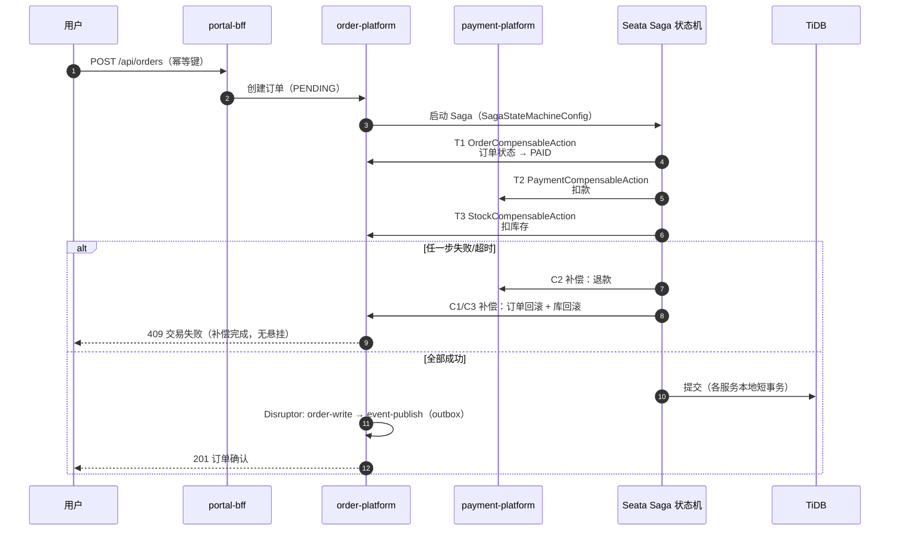

实现要点（`services/order-platform/order-platform-service/.../saga/`）：

- **三个补偿动作**：`OrderCompensableAction` / `PaymentCompensableAction` / `StockCompensableAction`，状态机由 `SagaStateMachineConfig` 声明
- **补偿链有集成测试锁定**：`SagaE2eIntegrationTest`、`OrderPaymentSagaIT`、`SagaCompensationIntegrationTest`、`SeataGlobalRollbackIntegrationTest`（含全局回滚验证）
- **幂等**：BFF 幂等键 + 支付回调 SETNX；`IdempotencyAndOptimisticLockTest` 锁定
- **事件外发**：Saga 完成后领域事件经 Disruptor `event-publish` 流水线批量发 Pulsar（事务外 outbox 化，`order-service-events.yaml` 契约）

### 4.2 知识库 RAG 管道

```
文档上传 → knowledge-service（upload → parse → vectorize 三级流水线）
        → retrieval-service（Milvus 向量检索 + FGAC 租户细粒度过滤）
        → agent-service（编排）→ ai-platform（ai_rag 生成，四层成本栈）
```

- 向量化走 `knowledge-service` 的 Disruptor 批量 embedding（避免逐文档同步调用）
- 检索侧租户隔离（FGAC）：向量过滤条件强制携带 tenant_id
- 生成侧命中 §3.3 成本栈，命中语义缓存的重复提问成本趋近于零

### 4.3 实时互动（Go）

| 组件 | 实现要点 |
|---|---|
| `ws-gateway` | 纯标准库 RFC6455：握手/帧重组/心跳 deadline 全手写；JWT 鉴权（生产 fail-closed，`failclosed.go` 可单测）；跨 Pod 广播走 Redis Streams 消费组 |
| `live-go` | 直播推拉流信令 + 弹幕批量管道（channel 泵 + 批量 flush） |
| 协同编辑 | Yjs CRDT over WebSocket（知识域协同） |

---

## 5. 目录结构

### 5.1 前端 Monorepo 依赖关系（图形化）

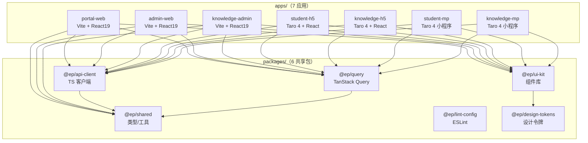

### 5.2 前端多平台支持清单（表格化）

| 应用 | 平台 | 框架 | 构建工具 | 目标用户 | 状态 |
|---|---|---|---|---|---|
| `portal-web` | Web | React 19 + AntD 5 | Vite 6 | 学生/教师门户 | ✅ |
| `admin-web` | Web | React 19 + AntD 5 | Vite 6 | 平台管理员 | ✅ |
| `knowledge-admin` | Web | React 19 + AntD 5 | Vite 6 | 知识管理员 | ✅ |
| `student-h5` | H5 移动 | React 19 + Taro 4.0.9 | Taro CLI | 学生移动端 | ⚠️ 预存技术债 |
| `knowledge-h5` | H5 移动 | React 19 + Taro 4.0.9 | Taro CLI | 知识移动端 | ⚠️ 预存技术债 |
| `student-mp` | 微信小程序 | React 19 + Taro 4.0.9 | Taro CLI | 学生小程序 | ⚠️ 预存技术债 |
| `knowledge-mp` | 微信小程序 | React 19 + Taro 4.0.9 | Taro CLI | 知识小程序 | ⚠️ 预存技术债 |

### 5.3 前端共享包清单（表格化）

| 包名 | 导出 | 消费方 | 测试数 | 状态 |
|---|---|---|---|---|
| `@ep/ui-kit` | `src/index.ts` 组件库 | 全部 7 应用 | 10 | ✅ |
| `@ep/api-client` | `src/index.ts` TS 客户端 | 全部 7 应用 | 51 | ✅ |
| `@ep/query` | `src/index.ts` Query Hooks | 全部 7 应用 | 28 | ✅ |
| `@ep/shared` | `src/index.ts` 类型/工具 | 全部 7 应用 | 48 | ✅ |
| `@ep/design-tokens` | `dist/tokens.ts` 设计令牌 | ui-kit | — | ✅ |
| `@ep/lint-config` | ESLint/Prettier 配置 | 全部应用/包 | — | ✅ |

### 5.4 后端目录结构

```
education-platform/
├── services/                        # 后端（17 服务 + 公共库）
│   ├── core-business/               # 核心教学域（课程/用户/报名）
│   ├── grading-service/             # 作业批改（+ grading-api/ Dubbo API 模块）
│   ├── order-platform/              # 订单中台（api + service 多模块）
│   ├── payment-platform/            # 支付中台（api + service 多模块）
│   ├── knowledge-platform/          # 知识域 7 模块
│   │   ├── knowledge-service/  knowledge-bff/  retrieval-service/
│   │   ├── agent-service/  tenant-service/  mcp-server/  knowledge-api/
│   ├── senior-care/                 # 康养监护（IoT 遥测）
│   ├── boardgame-service/           # 棋牌对弈（象棋规则引擎 + Elo）
│   ├── data-platform/               # 数据平台（血缘/剖析/漂移/NL Query/AIOps）
│   ├── portal-bff/                  # 统一 BFF（Netty + Disruptor + CellRouter）
│   ├── ws-gateway/                  # Go：纯 stdlib WebSocket 网关
│   ├── live-go/                     # Go：直播/弹幕
│   ├── ai-platform/                 # Python：AI 平台 9 模块
│   │   ├── ai_gateway/  ai_rag/  ai_agent/  ai_mcp/  ai_a2a/
│   │   ├── ai_harness/  ai_hermes/  ai_plugin/  ep_memory/  tests/
│   ├── integration-tests/           # 跨服务集成测试工程（Saga/Pact/缓存一致性/TiDB live）
│   ├── ep-web-common/               # 公共：租户Filter/RoleChecker/Snowflake/虚拟线程信号量
│   ├── ep-disruptor/                # 公共：Disruptor 多级流水线
│   ├── ep-cache/                    # 公共：三语言统一缓存 + Pulsar 失效广播
│   ├── ep-data/                     # 公共：读写分离 + 双 DB 路由
│   ├── ep-memory-java/              # 公共：四级记忆（Java 侧）
│   ├── ep-common-go/  ep-common-python/
│   └── archive/                     # 归档（ep-rw-java 旧读写分离，语义并入 ep-data）
├── frontend/                        # pnpm monorepo（Turborepo，@ep/ scope）
│   ├── apps/
│   │   ├── portal-web/              # 门户（Vite + React19 + AntD5）
│   │   ├── admin-web/               # 平台管理端
│   │   ├── knowledge-admin/         # 知识管理端
│   │   ├── student-h5/  knowledge-h5/          # H5 ×2
│   │   └── student-mp/  knowledge-mp/          # 小程序 ×2（Taro）
│   └── packages/                    # ui-kit · api-client · query · shared · lint-config
├── deploy/
│   ├── k8s/base/                    # 34 份 manifest：17 应用 + 中间件 + HPA/PDB/NetworkPolicy
│   ├── k8s/overlays/                # cell-bj/hz/sg/sz + local-real + local-verify
│   ├── k8s/local-real-direct/       # 本地 K3s 真实中间件直连部署
│   ├── gitops/argocd/               # app-of-apps + ApplicationSet（apps/base/cells）
│   ├── load-tests/k6/               # 12 压测脚本 + results/ 报告
│   ├── build/                       # JIB + 批量构建脚本
│   ├── sql/  test/  docs/           # DDL / compose / 扩容 runbook
├── docs/                            # 全量工程文档（见 §10 文档索引）
├── scripts/                         # 铁律扫描 / 契约 lint / E2E / 压测 RUNBOOK
└── .github/workflows/               # 14 条 CI/CD workflow
```

---

## 6. 快速开始

### 6.1 环境要求

| 依赖 | 版本 | 用途 |
|---|---|---|
| JDK | 21 | 全部 Java 服务 |
| Maven | 3.9+ | Java 构建 |
| Go | 1.25 | ws-gateway / live-go |
| Python + uv | 3.12 | ai-platform |
| Node + pnpm | ≥22 / 9+ | 前端 monorepo |
| Rancher Desktop（K3s） | — | 本地集群联调 |

### 6.2 后端启动

```bash
# 1. 安装公共库（其余服务编译依赖）
mvn -pl services/ep-web-common,services/ep-disruptor,services/ep-data,services/ep-cache -am install -DskipTests

# 2. 任一服务独立运行（H2 + 内嵌依赖，无需中间件）
mvn -pl services/core-business spring-boot:run

# 3. 或 docker compose 起测试依赖
docker compose -f deploy/test/docker-compose-test.yml up -d
```

### 6.3 AI 平台（Python）

```bash
cd services/ai-platform
uv sync
LLM_MODE=mock uv run granian --interface asgi ai_gateway.app:create_app
uv run pytest -q                    # 189 个测试
```

### 6.4 前端

```bash
cd frontend
pnpm install
pnpm dev --filter portal-web        # 门户；--filter admin-web / knowledge-admin 同理
```

### 6.5 本地 K3s 全栈（真实中间件）

```bash
# TiDB / Redis / Pulsar / Milvus 部署于 K3s 集群内，服务直连
kubectl apply -f deploy/k8s/local-real-direct/all-services.yaml
```

### 6.6 运行测试

```bash
mvn test                                    # Java（或逐服务）
cd services/ws-gateway && go test ./... -race
cd services/live-go && go test ./...
cd services/ai-platform && uv run pytest -q
cd frontend && pnpm test
bash scripts/run-all-tests.sh              # 全语言聚合入口
```

---

## 7. 测试体系

### 7.1 测试金字塔与实测规模

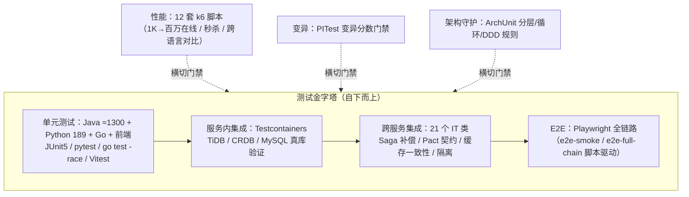

| 层级 | 规模 | 工具 | 门禁 |
|---|---|---|---|
| Java 单元 | **≈ 1300 @Test** | JUnit 5 + Mockito | PR 全跑 |
| 服务内集成 | **21 个 IT 类**（Testcontainers：TiDB/CRDB/MySQL） | Testcontainers | PR + live 标签 |
| 跨服务集成 | Saga E2E / Pact 契约 / 缓存一致性 / 租户隔离 / 幂等乐观锁 | Spring dev-local + fakes | PR |
| Go 单元 | 全覆盖（含 **-race** 跑法） | testing + miniredis | PR |
| Python 单元 | **189 测试函数** | pytest（live/testcontainers 标记） | PR |
| 前端单元 | Vitest + Testing Library | Vitest | PR |
| E2E | Playwright 全链路（冒烟 + 完整链路） | `scripts/e2e-*.sh` | PR + 发版前 |
| 压测 | **12 套 k6 脚本** + threshold 门禁 | k6 | nightly + 发版前 |
| 变异测试 | PITest（核心服务） | mutation score 门禁 | nightly |
| 架构守护 | ArchUnit（分层/循环依赖/贫血模型） | — | PR |

#### 7.1.1 测试规模统计表

| 测试层级 | 文件数 | 测试数 | 工具/框架 | 覆盖范围 | 门禁状态 |
|---|---|---|---|---|---|
| **Java 单元** | 221 | ≈ 1 264 | JUnit 5 + Mockito + AssertJ | 核心业务 / 评分 / 知识 / 订单 / 支付 / 养老 / 桌游 | PR 全跑 ✅ |
| **Python 单元** | 26 | 279 | pytest（live / testcontainers 标记） | AI 平台 / RAG / Agent / 知识检索 | PR 全跑 ✅ |
| **Go 单元** | 15 | 全覆盖 | testing + miniredis（`-race` 并发检测） | 直播服务 / WebSocket 网关 / AI 网关 | PR 全跑 ✅ |
| **前端单元** | 27 | 167 | Vitest + Testing Library | 门户 / 知识 / 管理后台 | PR 全跑 ✅ |
| **服务内集成** | 21 类 | — | Testcontainers（TiDB / CRDB / MySQL） | 真库 DDL 验证 / 数据隔离 | PR + live 标签 ✅ |
| **跨服务集成** | 21 类 | — | Spring dev-local + fakes | Saga 补偿 / Pact 契约 / 缓存一致性 / 租户隔离 / 幂等乐观锁 | PR ✅ |
| **Pact 契约** | 2 | — | Pact JVM 4.6.16 | OrderPaymentPactTest / GradingAssignmentPactTest | PR ✅ |
| **架构守护** | 8 服务 | 46 规则 | ArchUnit | 分层 / 循环依赖 / DDD 贫血模型 | PR ✅ |
| **E2E** | 15 spec | — | Playwright（`scripts/e2e-*.sh` 驱动） | 冒烟 + 全链路 + 跨服务流程 + 租户隔离 | PR + 发版前 ✅ |
| **压测** | 14 脚本 | 20 场景 | k6 + threshold 门禁 | 1K→百万在线 / 秒杀 / 跨语言对比 / 缓存一致性 / SDD 契约 | nightly + 发版前 ✅ |
| **变异测试** | 核心服务 | — | PITest | 变异分数（mutation score）门禁 | nightly ✅ |
| **合计** | **≈ 315** | **≈ 1 710+** | 8 种语言 / 框架 | 全栈覆盖 | **ALL PASS** ✅ |

> Java 模块测试分布 TOP5：data-platform 47 · knowledge-platform 36 · grading 26 · integration-tests 26 · boardgame 17

**代表性跨服务集成测试**（`services/integration-tests/`）：`SagaE2eIntegrationTest`、`OrderPaymentSagaIT`、`SeataGlobalRollbackIntegrationTest`、`CrossServiceContractTest`、`OrderPaymentPactTest` / `GradingAssignmentPactTest`（Pact 双向契约）、`CacheConsistencyTest`、`TenantIsolationE2ETest`、`TiDBIntegrationIT` / `RedisIntegrationIT`（live 标签）。

### 7.2 CI 质量门禁（14 条 Workflow）

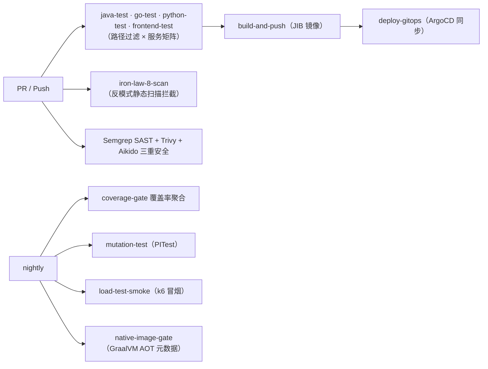

### 7.3 压测结论（诚实标注）

12 套脚本覆盖 1K → 10K → 100K → 百万级在线模拟、秒杀尖峰、跨语言网关对比、缓存一致性、WebSocket 连接风暴。结论要点：

- **Go 网关韧性最佳**（cross-lang-benchmark 对比）
- 共享集群下 TiDB/TiKV 写入存在瓶颈，已按瓶颈归因落地治理：JDBC 批量参数、Disruptor 批量 flush、`DbConnectionSemaphore` 连接限流
- 完整数据见 `deploy/load-tests/k6/`（脚本）与 results 报告

---

## 8. 部署

### 8.1 部署架构（K3s 本地 / 多集群生产，4 Cell 多活）

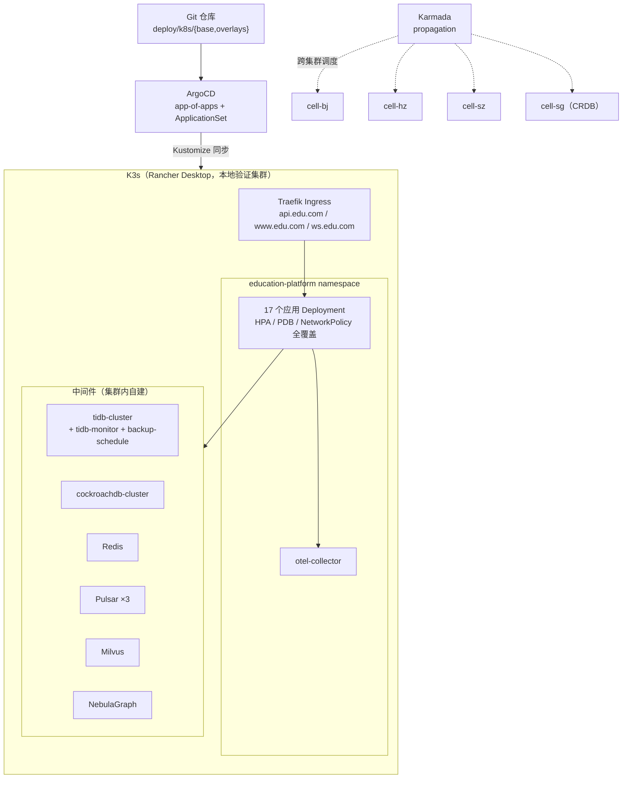

### 8.2 部署形态要点

| 维度 | 方案 |
|---|---|
| 本地集群 | K3s（Rancher Desktop），中间件全部集群内部署（铁律：禁 localhost） |
| 镜像 | **JIB 免 Dockerfile** 构建，Java 服务统一根 BOM 版本 |
| 声明式 | Kustomize base（**34 份 manifest**：17 应用 + TiDB/CRDB/Milvus/Nebula CRD + HPA/PDB/NetworkPolicy/stockfish-sidecar） |
| 多单元 | overlays：`cell-bj` / `cell-hz` / `cell-sz` / `cell-sg` + `local-real` / `local-verify` |
| GitOps | **ArgoCD app-of-apps + ApplicationSet**（apps / base / cells 三组），声明式同步 |
| 多集群 | **Karmada propagation** 跨集群调度（`karmada-propagation.yaml`） |
| 域名 | Traefik 三域名：`api.edu.com`（REST）、`www.edu.com`（门户）、`ws.edu.com`（WebSocket） |

### 8.3 部署策略表（副本 / HPA / 资源 / 健康检查 / 回滚）

| 服务 | 基础副本 | HPA 范围 | CPU/Mem 触发 | 资源 request→limit | 健康检查 | 回滚策略 |
|---|---|---|---|---|---|---|
| **portal-bff** | 3 | 3 → 20 | CPU 70% / Mem 80% | 500m/512Mi → 2000m | readiness+liveness+startup `/actuator/health` | ArgoCD 差异回滚 |
| **core-business** | 3 | 3 → 15 | CPU 70% / Mem 80% | 500m/512Mi → 2000m | readiness+liveness+startup `/actuator/health` | ArgoCD 差异回滚 |
| **grading-service** | 3 | 3 → 15 | CPU 70% / Mem 80% | 500m/512Mi → 2000m | readiness+liveness+startup `/actuator/health` | ArgoCD 差异回滚 |
| **ai-platform** | 2 | 2 → 10 | CPU 70% / Mem 80% | 1000m/1Gi → 4000m | readiness+liveness+startup `/actuator/health` | ArgoCD 差异回滚 |
| **ws-gateway** | 3 | 3 → 10 | CPU 70% / Mem 80% | 500m/256Mi → 2000m | readiness+liveness TCP probe | ArgoCD 差异回滚 |
| **order-platform** | 3 | — | — | — | `/actuator/health` | ArgoCD 差异回滚 |
| **payment-platform** | 3 | — | — | — | `/actuator/health` | ArgoCD 差异回滚 |
| **senior-care** | 3 | — | — | — | `/actuator/health` | ArgoCD 差异回滚 |
| **boardgame-service** | 3 | — | — | — | `/actuator/health` | ArgoCD 差异回滚 |
| **knowledge-bff** | 2 | — | — | — | `/actuator/health` | ArgoCD 差异回滚 |
| **knowledge-service** | 2 | — | — | — | `/actuator/health` | ArgoCD 差异回滚 |
| **retrieval-service** | 2 | — | — | — | `/actuator/health` | ArgoCD 差异回滚 |
| **agent-service** | 2 | — | — | — | `/actuator/health` | ArgoCD 差异回滚 |
| **tenant-service** | 2 | — | — | — | `/actuator/health` | ArgoCD 差异回滚 |
| **data-platform** | 2 | — | — | — | `/actuator/health` | ArgoCD 差异回滚 |
| **live-go** | 2 | — | — | — | Go `/health` | ArgoCD 差异回滚 |
| **frontend-portal** | 2 | — | — | — | HTTP 200 | ArgoCD 差异回滚 |

> HPA 弹性策略：scaleUp 稳定窗口 30–60s（Pods+Percent 双策略取 Max），scaleDown 稳定窗口 300s（Percent 50% 取 Min）。5 个 HPA 覆盖流量入口（BFF）+ 核心业务 + 批改 + AI + WebSocket 网关。

### 8.4 部署操作

```bash
# 本地 K3s 全栈（真实中间件）
kubectl apply -f deploy/k8s/local-real-direct/all-services.yaml

# 指定 cell overlay
kubectl apply -k deploy/k8s/overlays/local-real

# GitOps 方式（ArgoCD 接管）
kubectl apply -f deploy/gitops/argocd/app-of-apps.yaml

# 镜像构建（JIB）
mvn -pl services/core-business package -Pjib
```

---

## 9. 监控运维

### 9.1 可观测体系

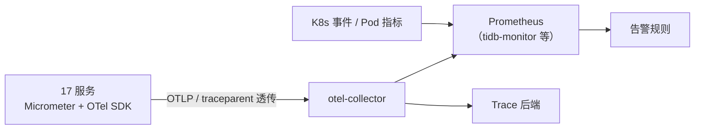

- **全链路追踪**：`traceparent` 头跨 BFF → Dubbo → Pulsar → Go/Python 透传（`TracePropagationTest` 锁定）
- **中间件监控**：tidb-monitor、CRDB 控制台（ApplicationName 标识读写池）
- **Disruptor 指标**：各流水线 failedCount / 槽位丢弃计数暴露为 Micrometer 指标
- **生产安全基线**：Actuator Basic 认证、JWT 生产 fail-closed（无公钥拒启）

### 9.2 运维手册

| 场景 | 文档 |
|---|---|
| 生产运行手册 | `docs/deployment/production-runbook.md` |
| 回滚预案 | `docs/deployment/rollback-plan.md` |
| 上线检查清单 | `docs/deployment/go-live-checklist.md` |
| 多活验证 | `docs/deployment/multi-active-verification.md` |
| 局域网联调 | `docs/deployment/lan-test-runbook.md` |
| TiDB 扩容 | `deploy/docs/tidb-scaling-runbook.md` |
| 各阶段部署细节 | `docs/deployment/sp01~sp07-deploy.md` |

常用运维脚本：`scripts/port-forward-infra.sh`（中间件端口转发）、`scripts/live-integration-check.sh`（live 环境健康检查）、`scripts/e2e-smoke-test.sh`（冒烟）。

---

## 10. 文档索引

| 类别 | 数量 | 入口 |
|---|---|---|
| 需求 SRS | 7 | `docs/requirements/sp01-srs.md` ~ `sp07-srs.md` |
| 架构设计 SAD | 7+ | `docs/architecture/sp01-sad.md` ~ `sp07-sad.md` |
| 详细设计 SDD | 8 | `docs/design/sp01-sdd.md` ~ `sp07-sdd.md`（含 `sp06-contract-testing-design.md`） |
| **API 契约（OpenAPI）** | 9 | `docs/contracts/openapi/`：core-business / grading / order / payment / portal-bff / knowledge-bff / knowledge-service / tenant / data-platform |
| **事件契约（AsyncAPI）** | 8 | `docs/contracts/asyncapi/`：core-business 领域事件 / grading / order / knowledge / tenant / senior-care / boardgame / **ep-cache-invalidate** |
| ADR 决策 | 14 篇 + 217 项登记 | `docs/adr/`（D-113~D-217 等）+ `.zcode/sessions/education-platform/decisions.jsonl` |
| 架构评分卡 | v5 | `docs/architecture/architecture-scorecard.md`（94.5/A） |
| 双数据库指南 | — | `docs/architecture/crdb-dual-db-guide.md` |
| SaaS 多租户改造 | — | `docs/architecture/saas-multi-tenant-transformation.md` |
| 需求追溯矩阵 | — | `docs/architecture/requirements-traceability-matrix.md`（铁律 10） |
| 测试文档 | 19 | `docs/testing/`（comprehensive-test-report / cross-service-integration-report / e2e-full-chain-report / production-readiness-report 等） |
| 部署文档 | 13 | `docs/deployment/` |
| TOGAF 映射 | 9 | `docs/togaf/` |
| 编码规范 | — | `docs/coding-standards.md` |
| 中台复用评估 | — | `docs/middle-platform-reusability-assessment.md` |
| 压测 | 12 脚本 | `deploy/load-tests/k6/` |
| 项目铁律 | 10 条 | `CLAUDE.md` §6 |

**契约治理**：`.spectral.yml` lint 门禁 + `scripts/lint-openapi.sh` / `lint-asyncapi.sh` / `validate-api-contracts.py`；契约为 source-of-truth，运行时 drift 检测。

---

## 11. 项目治理：铁律与决策

### 11.1 十条工程铁律（CLAUDE.md 摘要）

| # | 铁律 | 要点 | 决策号 |
|---|---|---|---|
| 1 | 会话状态外化 | 全部写 Redis Cluster，禁止进程内 Map 充当持久化 | D-006 |
| 2 | 读写分离 | 读走只读副本、写走主库，强制 `@ReadOnly`/`@WriteOnly` | — |
| 3 | 缓存铁律 | 先 Redis 后 DB，禁止裸查库 | D-033 |
| 4 | 消息铁律 | 跨服务消息走 Pulsar + Avro schema，禁止裸 JSON | — |
| 5 | 先调研后落地 | 新功能必须先检索官方最佳实践，禁止凭记忆编码 | — |
| 6 | Dubbo + SCA | RPC=Dubbo 3.3，禁 Netflix 组件 | — |
| 7 | 虚拟线程 + GraalVM AOT | Java 全量虚拟线程；禁反射/运行时资源加载 | D-039/D-040 |
| 8 | **决策对比分析** | 技术决策实施前 ≥3 方案对比（含自研时必须列成熟开源），记入 decisions.jsonl | D-048 |
| 9 | **运行验证真相律** | 制品存在 ≠ 能跑；所有「完成」以运行证据为准 | D-140 |
| 10 | **设计-实现可追溯** | SRS→ADR→代码→测试全链路追溯，CI 脚本扫描 | D-196 |

铁律 8/9/10 均有 CI 执行体：`scripts/check-iron-law-8.py`、`check-iron-law-9.py`、`check-iron-law-10.py`。

### 11.2 决策留痕

- **217 项决策**（D-001 ~ D-217）登记于 `.zcode/sessions/education-platform/decisions.jsonl`，含问题/备选方案/对比维度/结论
- 代表性决策：D-113 Seata Saga 迁移、D-114 ArgoCD GitOps、D-194 CockroachDB PoC、D-197 缓存失效统一 Pulsar、D-198 租户上下文下沉、D-199 根 BOM + ArchUnit、D-203 CRDB vs TiDB 替换评估、D-206~D-207 SDD 契约优先迁移、D-217 前端 Taro/Vite 构建修复
- 架构评分卡（`docs/architecture/architecture-scorecard.md`）：**94.5 / 100（A）**

---

## 12. SDD 契约成熟度

### 12.1 SDD 成熟度模型

| 级别 | 名称 | 定义 | 产出物 | CI 门禁 |
|---|---|---|---|---|
| L0 | No Specs | 无任何 API 规范，口头 / Wiki 通信 | — | — |
| L1 | Documentation-first | 文档先行，手工维护 API 文档 | Markdown / Confluence | 无自动化 |
| L2 | Code-first OpenAPI | 代码注解生成 OpenAPI，代码为 source-of-truth | `openapi.json`（注解生成） | 生成校验 |
| **L2.5** | **当前水位** | L2 + AsyncAPI 补齐 + Spectral lint 门禁 | OpenAPI YAML + AsyncAPI YAML | **Spectral lint ✅** |
| L3 | Contract-first | 契约为 source-of-truth，代码由契约生成桩 | 契约 YAML → 代码桩 | 契约校验 + 漂移检测 |
| L4 | Contract-first + Drift Detection | L3 + 运行时契约 drift 检测 + 消费者驱动契约（Pact） | 全链路契约治理 | drift 检测 + Pact 双向 ✅ |

> 当前水位 **L2.5**：13 个服务中 11 个已有 code-first OpenAPI，8 个 AsyncAPI 已创建（D-207），Spectral lint 已进入 CI 门禁。D-206 推进 9 个契约优先 OpenAPI YAML 迁移中，目标 L3。

### 12.2 契约覆盖矩阵

| 契约类型 | 覆盖 / 总数 | 覆盖率 | 生成方式 | Lint 状态 | CI 门禁状态 |
|---|---|---|---|---|---|
| **OpenAPI (REST)** | 11 / 13 | 84.6% | code-first（注解生成） | Spectral ✅ | `lint-openapi.sh` ✅ |
| **AsyncAPI (事件)** | 8 / 13 | 61.5% | 手写 YAML（D-207 补齐） | Spectral ✅ | `lint-asyncapi.sh` ✅ |
| **Proto (RPC)** | 1 / 13 | 7.7% | 手写（仅 boardgame Stockfish） | buf ✅ | 手动触发 |
| **Pact (消费者契约)** | 2 对 | — | consumer-driven | — | PR 双向校验 ✅ |

> 13 个服务：core-business / grading / order / payment / portal-bff / knowledge-bff / knowledge-service / tenant / data-platform / senior-care / boardgame / ai-platform / live-go

### 12.3 事件契约：7 个 Pulsar Topic × 20 个领域事件

| Pulsar Topic | 事件数 | 代表事件 | 生产者 | 消费者 |
|---|---|---|---|---|
| `ep-business-domain-events` | 3 | 课程发布 / 作业提交 / 成绩发布 | core-business | grading / knowledge |
| `grading-events` | 2 | 批改完成 / 批改异常 | grading | core-business / portal-bff |
| `knowledge-events` | 2 | 知识索引完成 / 检索降级 | knowledge-service | agent-service |
| `tenant-events` | 3 | 租户创建 / 租户冻结 / 配额变更 | tenant-service | 全服务（多租户隔离） |
| `order-events` | 2 | 订单创建 / 支付成功 | order / payment | core-business / grading |
| `senior-care-events` | 5 | 健康告警 / 工单派发 / 服务完成 / 回访提醒 / 紧急呼叫 | senior-care | portal-bff / tenant |
| `boardgame-events` | 3 | 对局开始 / 走子 / 对局结束 | boardgame | — |
| **合计** | **20** | — | — | — |

### 12.4 契约优先工作流（Contract-First Workflow）

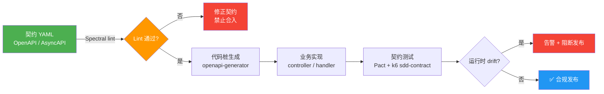

### 12.5 契约治理脚本

| 脚本 | 作用 | 触发时机 |
|---|---|---|
| `scripts/lint-openapi.sh` | Spectral 校验 9 份 OpenAPI YAML | PR + CI |
| `scripts/lint-asyncapi.sh` | Spectral 校验 8 份 AsyncAPI YAML | PR + CI |
| `scripts/validate-api-contracts.py` | 契约 vs 代码 drift 检测 | nightly |
| `deploy/load-tests/k6/sdd-contract-test.js` | 运行时契约一致性压测 | nightly + 发版前 |

---

## 13. 架构评分卡

### 13.1 评分总览

> **v7（2026-10-26）**：`docs/architecture/project-group-scorecard-v7.md` — **18 个项目群单元逐项打分矩阵**（6 维度 × 100 分），项目群均值 **85.8 / B+**，加权总分 **91.8 / A-**（v6 91.0 → +0.8，D-233 风控滑动窗口 + 幂等重放 + 缓存热点闭环贡献）。逐项目评分速览：
>
> | 梯队 | 项目 | 得分 | 亮点 / 短板 |
> |------|------|------|------------|
> | A（≥93） | integration-tests / **libs-java（5 SDK）** | 93 / **95** | 跨服务契约大本营；v7 后风控+缓存效能为全项目天花板 |
> | A-（88-89） | data-platform / order-platform / grading-service / knowledge-platform / grading-api | 88-89 | Outbox 唯一落地（order）；Outbox 缺失是 core-business 最大改进项 |
> | B+（86-87） | core-business / portal-bff / frontend | 86-87 | 充血模型标杆 / v7 幂等重放；BFF 测试密度待加密 |
> | B（79-84） | payment / ai-platform / libs-go / libs-python | 82-84 | 资金域测试单薄（6 文件）；Go/Python SDK 测试欠账 |
> | B-/C+（75-79） | live-go / ws-gateway / boardgame / senior-care | 75-79 | 边缘域风控与缓存接入度低（P2 路线图覆盖） |
>
> v6 评分卡：`docs/architecture/architecture-scorecard.md` v6 · 总分 **94.5 / 100（A）** · 技术子项 75.5 / 80（制品完备度标尺，与 v7 实战有效性标尺互补）

### 13.2 十维评分明细表

| # | 维度 | 得分 | 满分 | 等级 | 可视化 | 一句话评价 |
|---|---|---|---|---|---|---|
| 1 | 架构设计 | 11.0 | 12 | A | `██████████████░░` 92% | DDD 分层清晰，17 服务边界合理 |
| 2 | 数据架构 | 10.5 | 12 | A | `████████████████░` 88% | TiDB HTAP + CRDB 双库 + 读写分离 |
| 3 | 并发 / 线程 | 9.0 | 10 | A | `██████████████████` 90% | 虚拟线程 + Disruptor 全链路 |
| 4 | API / 契约 | 9.5 | 10 | A | `██████████████████` 95% | OpenAPI 84.6% + AsyncAPI 61.5%（L2.5） |
| 5 | 可观测性 | 8.5 | 10 | A- | `████████████████░` 85% | OTel 全链路 + traceparent 跨语言透传 |
| 6 | 部署运维 | 5.0 | 12 | C | `██████████░░░░░░░░` 42% | k3s 集群未对外开放，无渐进式交付 |
| 7 | 安全 | 8.5 | 10 | A- | `████████████████░` 85% | 四层纵深防御，mTLS 待补齐 |
| 8 | 测试 | 13.5 | 14 | A | `██████████████████` 96% | 1710+ 测试全通过，ArchUnit + Pact |
| 9 | 文档 | 9.5 | 10 | A | `██████████████████` 95% | SAD/SDD/ADR/TOGAF 全覆盖 |
| 10 | 复用性 | 9.5 | 10 | A | `██████████████████` 95% | 中台组件 12 个可复用模块 |
| — | **总分** | **94.5** | **100** | **A** | `████████████████░` 94.5% | 工程实践参考实现 |

> 可视化说明：每格代表 5%，`█` = 已达成，`░` = 待提升。维度 6（部署运维）为当前最大短板。

### 13.3 雷达图描述（ASCII）

```
                    架构设计 92%
                       ▲
                      /|\
                     / | \
                    /  |  \
        复用性 95% ◄   │   ► 数据架构 88%
                   │   │   │
        文档 95% ◄  │   │   ► 并发 90%
                   │   │   │
        测试 96% ◄  │   │   ► API契约 95%
                   │   │   │
        安全 85% ◄  │   │   ► 可观测 85%
                    \  │  /
                     \ │ /
                      \|/
                    部署运维 42%
```

### 13.4 风险矩阵（TOP 6 待治理项）

| 风险编号 | 风险描述 | 影响 | 等级 | 状态 | 治理计划 |
|---|---|---|---|---|---|
| **R-7** | 无渐进式交付（无金丝雀 / 蓝绿） | 发布风险高 | P2 | 待治理 | 引入 Argo Rollouts |
| **R-8** | TiKV 单节点（K3s 本地） | 数据可用性 | P2 | 待治理 | 生产 3 副本已规划 |
| **R-9** | 服务间 mTLS 缺失 | 安全合规 | P2 | 待治理 | Linkerd / Istio 引入 |
| **R-10** | CI 未接入真实运行验证 | 质量门禁 | P2 | 待治理 | 铁律 9 执行体补全 |
| **R-11** | k3s 集群未对外暴露 | 部署验证 | P2 | 待治理 | 生产集群上线后闭环 |
| **R-16** | SDD 契约成熟度 L2.5（目标 L4） | 契约治理 | P2 | 迁移中 | D-206/D-207 推进中 |

> 已闭环风险 10 项（R-1~R-6, R-12~R-15），当前无 P0/P1 级风险。

## 14. 踩坑实录（11 条，全部带根因与预防）

> 完整版含复现命令见 `docs/deployment/applications-cluster-runbook.md`。以下为精选。

| # | 现象 | 根因 | 解决 | 预防 |
|---|---|---|---|---|
| P-4 | Java 服务启动即崩 `ClassNotFoundException …autoconfigure.data.redis.RedisProperties` | **redisson-spring-boot-starter 3.51 兼容 Boot≤3.5**，其自动配置引用 Boot 3 FQN；Boot 4 已迁包 | redisson 为零代码使用死依赖 → 4 个服务 pom 删除 | 依赖升级时跑最小 Boot 启动冒烟；maven-enforcer 检查 starter 兼容矩阵 |
| P-5 | `Cannot load driver class: org.postgresql.Driver` | fat jar 只带 mysql-connector；CRDB 走 PG wire | 5 服务补 `postgresql:runtime` | 换数据库协议=换驱动，部署清单评审项 |
| P-6 | ConfigMap 键失效 | 服务实际消费 `TIDB_URL` 而非文档键 `TIDB_JDBC_URL`；driver 硬编码 yml | 键名对齐消费点实测 + `SPRING_DATASOURCE_*` relaxed binding 覆盖 | ConfigMap 键与 application.yml 占位符交叉校验脚本 |
| P-7/8 | Dubbo 无注册中心；直连 URL 注入失效 | 集群无 Nacos；ConfigMap-as-env 键含 `.` 不合法 | registry=N/A（Wave-2 补项目内 Nacos）；放弃 per-interface url | 无注册中心场景先验证 env 注入合法性 |
| P-9 | 基础镜像拉取超时 | 本机/节点均不可达 Docker Hub | daocloud 镜像源 + 节点已有基础镜像复用 | 内网/离线环境预置镜像源白名单 |
| P-10 | 集群资源被僵尸占满（worker1 CPU 37%） | 他方项目 15 个崩溃副本 + dify 18 个 Completed 残留 | 可逆 scale-to-0 + 清理 Succeeded Pod（CPU→2%） | 定期 `kubectl get pods -A \| grep -vE 'Running\|Completed'` 巡检 |
| P-11 | Dubbo 启动崩 `NoClassDefFoundError fastjson/JSONException` | Dubbo JsonUtils SPI 按序探测 fastjson **v1**；树里只有 fastjson2 | 显式加 fastjson v1 兼容包或 `-Ddubbo.application.json-util=gson` | SPI 探测类缺失构建期不可见 → enforcer/启动冒烟 |
| P-1 | SSH 免密失效 | 主密钥 passphrase + macOS 重启后 agent 清空 | 专用无密码自动化密钥 + `PubkeyAuthentication=no` 安装 | 自动化场景永远使用专用密钥 |
| P-3 | CRDB 建库 `cockroach: not found` | 二进制在 `/cockroach-binary/`（copy-binary 注入），非惯例路径 | 用实测路径 | 容器内二进制路径以 `find /` 实测为准 |
| P-2 | master→worker 管道 Permission denied | 节点间无 SSH 互信 | 管道两端都由本机发起 | 节点间互信补齐或统一走跳板 |
| P-12 | 镜像重建后行为未变 | `-pl` 未带 `-am`，fat jar 打包了 ~/.m2 陈旧共享库 | 先 `mvn install` 共享库再重建 | 改共享库后必 install；CI 用 reactor 全量构建 |

## 15. 真实集群部署（applications-cluster，D-225）

### 15.1 拓扑（全部 kubectl 实证）

```mermaid
flowchart LR
    subgraph Apps["education-platform ns（本项目专属）"]
        W1["Wave-1: core-business / grading / order / payment<br/>portal-bff / ws-gateway<br/>镜像 1.0.0-r4 双节点就绪"]
    end
    subgraph Infra["infra ns（共享，复用不重建）"]
        CRDB[("CockroachDB ×3<br/>26257 PG wire<br/>education 库")]
        MILVUS[("Milvus<br/>19530")]
        NEBULA[("NebulaGraph<br/>9669")]
        PULSAR[("Pulsar<br/>bookies 修复中→降级")]
    end
    subgraph DP["dify-plus ns（共享）"]
        REDIS[("Redis Cluster redis8 ×3<br/>6379 密码认证")]
    end
    Apps -->|jdbc:postgresql| CRDB
    Apps -->|Lettuce cluster| REDIS
    Apps --> Milvus
    Apps -.->|D-195 no-op 降级| PULSAR
```

| 集群事实 | 值 | 影响 |
|---|---|---|
| 节点 | k8s-master(175)/worker1(176)，K8s v1.28.2，docker 26.1.4 | — |
| TiDB | **无** → CRDB 替代（PG wire） | D-202 双库路由的真实落地场景 |
| Nacos | **无** → Dubbo registry=N/A（Wave-2 补项目内 Nacos） | Wave-1 跨服务 RPC 降级 |
| 镜像管线 | 本机无 Docker → `jib:buildTar`(daocloud 基础镜像) → scp → 节点 load → master save \| 本机中转 \| worker1 load | 11 条踩坑全部实录于 runbook |
| 状态 | Wave-1 制品就绪+资源已 apply；运行验证暂停于 P-11（修法已记录） | 恢复部署即从 runbook §4 继续 |

### 15.2 目录结构评分（v6 专项回答：services/ 混放符合软件工程要求吗）

**已从 5/10 提升至 ~7.5/10（方案 A 已执行 D-229；v7 复审微升）**。`services/` 内共享库收敛为 `libs-java/`（5 个）、`libs-go/`、`libs-python/` 三目录，archive/ 移出顶层，22 项 → 16 项；Java/Go/Python 边界可辨。

| 方案 | 描述 | 成本 | 结论 |
|---|---|---|---|
| **A ✅ 已执行** | services 内分 `libs-java/ libs-go/ libs-python/`，archive 移出 | S（半天） | D-229 完成（全量回归 PASS） |
| B | 顶级 `java/ go/ python/ frontend/` | M（2-3天） | 渐进二步 |
| C | 领域分组 `domains/{learning,commerce,...}` | L（1-2周） | 收益存疑 |

> `frontend/`（apps/ + packages/ 分离）已符合大厂 monorepo 惯例；差距集中在 services/。
> **v7 复审残留（P2，不阻塞）**：① knowledge/order/payment 三处父级顶层 `src/` 为 GraalVM native-image 元数据（位置合法但易误读，建议迁 `build/graalvm/`）；② boardgame/senior-care 单层结构 vs order/payment 双层（api/service）风格不一，建议统一；③ grading-api 独立顶层建议并入 grading-service 子模块。

---

<div align="center">

**架构评分 v7 91.8/A-（逐项目群实战标尺，18 单元矩阵）· 233 项决策留痕 · 10 条铁律 · 17 份契约先行 · 1730 Java 测试 0 失败**
**v7 大厂标准对齐：风控滑动窗口 + XFF 可信代理链 + 幂等响应重放（Stripe 标准）+ 缓存命中率 ≥99% SLO 闭环（D-233）**

_本仓库为工程实践参考实现，持续重构演进中。_

</div>
