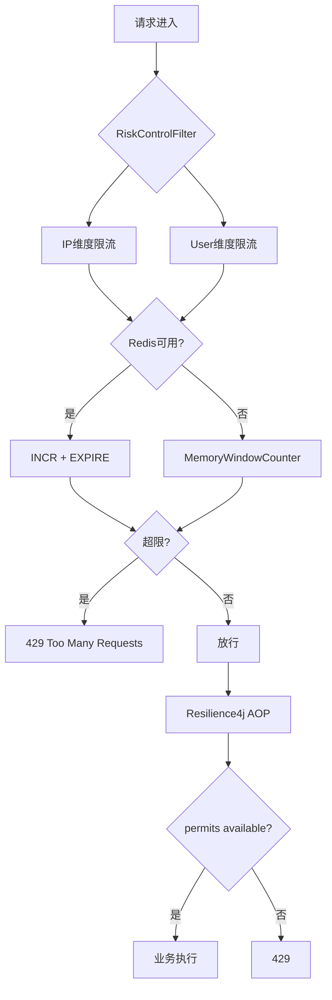
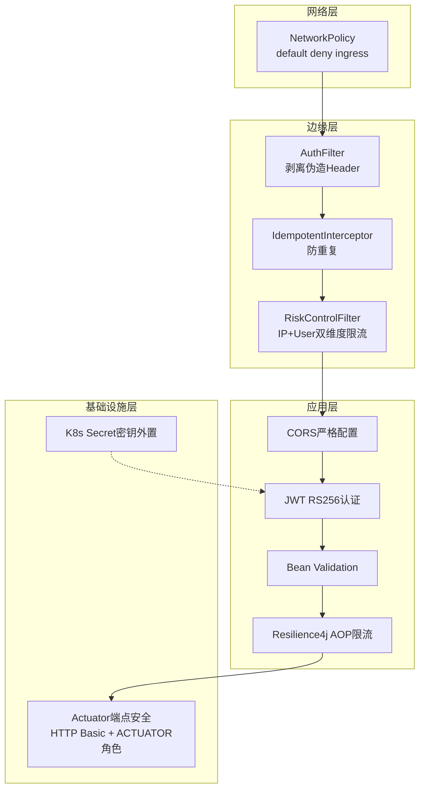
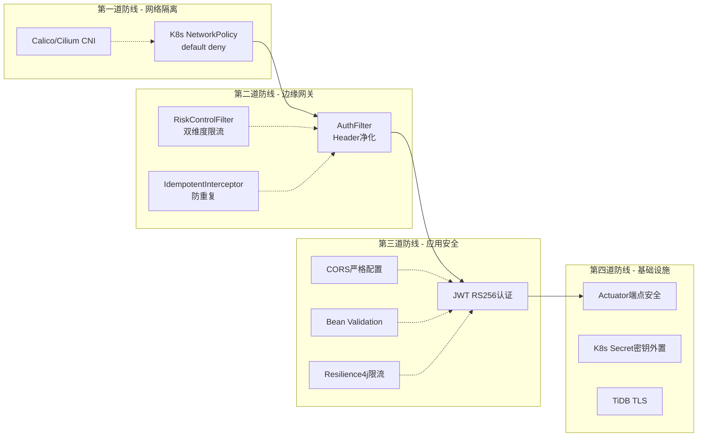
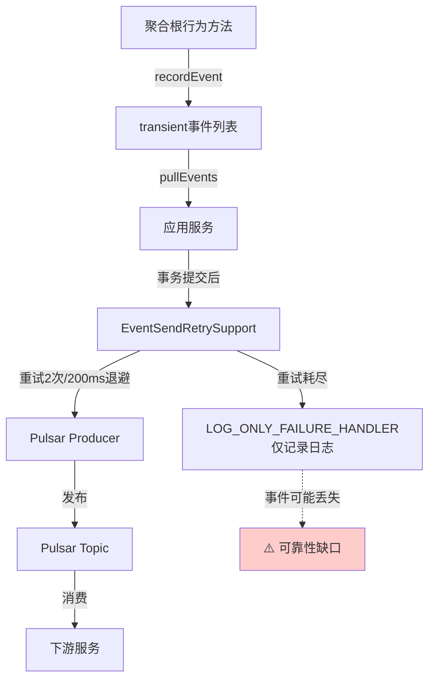
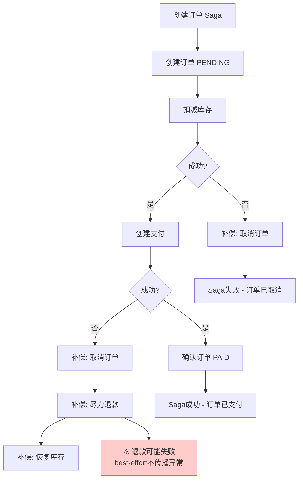
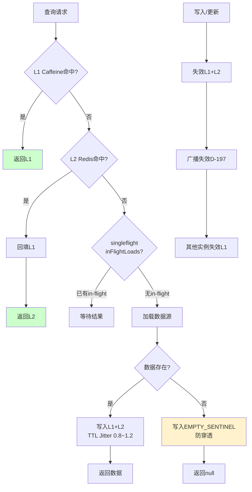

# 风控体系与架构深度分析报告 (Risk Control & Architecture Deep Analysis)

> **版本**: v1.0
> **日期**: 2026-08-16
> **范围**: education-platform 全栈（21 个微服务 + 通用 SDK + K8s 部署）
> **分析方法**: 基于实际源码逐文件阅读，非假设性推断

---

## 目录

1. [风控体系完整性分析](#1-风控体系完整性分析)
2. [DDD 充血模型分析](#2-ddd-充血模型分析)
3. [事件驱动架构分析](#3-事件驱动架构分析)
4. [读写分离分析](#4-读写分离分析cqrs--read-write-separation)
5. [多级缓存命中率提升空间分析](#5-多级缓存命中率提升空间分析)
6. [services/ 目录结构分析](#6-services-目录结构分析)
7. [总结与优先级行动项](#7-总结与优先级行动项)

---

## 1. 风控体系完整性分析

### 1.1 防重复（Idempotency）

#### 现状

防重复由 `IdempotentInterceptor` 实现，位于 portal-bff 边缘层，对所有写操作（POST/PUT/PATCH/DELETE）进行拦截。

**核心机制**：
- **Redis SETNX 原子占位**：使用 `idem:{key}` 前缀，24 小时 TTL
- **PENDING → DONE 状态机**：
  - 请求进入时，SETNX 写入 `PENDING` 状态
  - 业务成功后，更新为 `DONE`
  - 业务失败时，`afterCompletion()` 删除 key，允许客户端重试
- **幂等键来源**：客户端通过 `X-Idempotency-Key` Header 传入，服务端兜底使用 `tenantId + userId + method + path + bodyHash` 组合生成

**关键代码位置**：
- `services/portal-bff/src/main/java/com/ep/bff/edge/IdempotentInterceptor.java`

#### 分析

| 维度 | 实现情况 | 评价 |
|------|---------|------|
| 原子性 | Redis SETNX（单命令原子） | ✅ 正确 |
| TTL | 24h，覆盖大多数业务场景 | ✅ 合理 |
| 失败回滚 | afterCompletion 删除 PENDING key | ✅ 允许重试 |
| 状态机 | PENDING→DONE，防止并发重复 | ✅ 完整 |
| 拦截范围 | 仅 POST/PUT/PATCH/DELETE | ⚠️ GET 天然幂等，但需注意 GET 副作用场景 |
| Key 生成 | 客户端优先 + 服务端兜底 | ✅ 双保险 |

**PENDING 超时风险**：如果业务执行过程中进程崩溃（afterCompletion 未触发），key 会停留在 PENDING 状态直到 24h TTL 过期。这段时间内客户端重试会被拒绝。虽然 24h 后自动恢复，但对用户体验不友好。

#### 差距

1. **PENDING 状态无主动超时清理**：依赖 24h TTL 被动过期，无后台扫描任务清理僵尸 PENDING key
2. **无幂等键冲突检测日志**：当 SETNX 返回已存在 key 时，仅返回 409，未记录冲突详情（原 key 创建时间、是否同一客户端），排障困难
3. **分布式锁粒度**：SETNX 占位但不持有锁，若两个请求同时到达且 key 不存在，理论上有极小窗口竞态（Redis 单线程模型下实际安全，但语义不够显式）

#### 建议

1. **引入 PENDING 超时主动清理**：为 PENDING 状态设置独立的较短 TTL（如 5 分钟），配合后台扫描任务将超时的 PENDING key 标记为 FAILED 并删除，缩短重试等待窗口
2. **增强冲突日志**：SETNX 冲突时记录 `originalRequestId`、`originalTimestamp`、`currentRequestId`，写入结构化日志便于排障
3. **考虑 Redisson 分布式锁替代裸 SETNX**：显式 lock/unlock 语义更清晰，且自带 watchdog 续期，避免长事务场景下 key 过早过期

---

### 1.2 防滥用（Anti-Abuse）

#### 现状

防滥用由 `RiskControlFilter` 实现双维度限流（IP + User），采用固定窗口计数器算法。

**双维度限流策略**：
- **IP 维度**：所有请求按来源 IP 限流
- **User 维度**：已认证请求按 userId 限流
- **差异化阈值**：
  - 认证类路径（login/register/verify）：5 req/min（严格防暴力破解）
  - 其他路径：60 req/min（正常业务流量）

**实现细节**：
- **Redis INCR + EXPIRE**：首次 INCR 时设置 EXPIRE，实现固定窗口
- **内存兜底（MemoryWindowCounter）**：Redis 不可用时降级为内存计数器
- **MAX_TRACKED_KEYS = 100000**：内存兜底模式下限制追踪的 key 数量，防止 OOM
- **fail-open 策略**：Redis 不可用且内存计数器超限时，为可用性放行请求

**关键代码位置**：
- `services/ep-web-common/src/main/java/com/ep/web/common/RiskControlFilter.java`

**Resilience4j AOP 限流（补充层）**：
- `RateLimitAutoConfiguration` 提供 Resilience4j RateLimiter AOP
- 默认 `DEFAULT_LIMIT_FOR_PERIOD = 10 permits/s`
- `matchIfMissing = true`：默认开启
- 保守默认值仅在 YAML 未显式配置时应用

**关键代码位置**：
- `services/ep-web-common/src/main/java/com/ep/web/common/RateLimitAutoConfiguration.java`

#### 分析



| 维度 | 实现情况 | 评价 |
|------|---------|------|
| 双维度 | IP + User 并行检查 | ✅ 覆盖匿名和认证场景 |
| 算法 | 固定窗口计数器 | ⚠️ 有边界突刺问题 |
| 降级 | Redis→内存兜底 | ✅ 可用性优先 |
| fail-open | Redis 全挂时放行 | ⚠️ 极端场景风险 |
| 差异化阈值 | 认证路径 5/min vs 其他 60/min | ✅ 精细化 |
| 补充层 | Resilience4j AOP 10/s | ✅ 方法级细粒度补充 |

**固定窗口突刺问题**：在窗口边界（如 59s→60s 切换瞬间），客户端可在 1 秒内发送 2 倍阈值的请求（59s 末发 60 次 + 60s 初发 60 次 = 120 次/秒），形成流量突刺。

#### 差距

1. **固定窗口算法有突刺风险**：未使用滑动窗口或令牌桶，边界时刻可产生 2x 流量突刺
2. **无黑名单机制**：被限流的 IP/User 仅在当前窗口被拒绝，无累计违规计数→自动拉黑机制
3. **无人机验证（CAPTCHA）升级**：达到限流阈值后直接 429，未提供 CAPTCHA 作为"软降级"选项
4. **内存兜底的集群不一致性**：多实例部署时，内存计数器各自独立，实际限流阈值被放大 N 倍
5. **fail-open 极端风险**：Redis 集群故障期间，所有请求放行，攻击者可利用此窗口发动攻击

#### 建议

1. **升级为滑动窗口或令牌桶**：使用 Redis ZSET + ZREMRANGEBYSCORE 实现滑动窗口，或引入 Redisson RateLimiter（令牌桶），消除边界突刺
2. **引入违规积分→自动拉黑**：被限流的 IP/User 累计违规分，达到阈值后自动加入黑名单（Redis Set，1h~24h TTL），配合后台审计
3. **CAPTCHA 软降级**：达到阈值 80% 时返回 `429 + Retry-With-CAPTCHA` 提示，客户端完成验证后放行，而非硬拒绝
4. **内存兜底改进**：标注内存兜底为"尽力而为"模式，在日志和监控中明确告警，提醒运维 Redis 故障期间限流降级
5. **fail-open 加冷却**：Redis 故障期间，对认证类路径切换为 fail-closed（拒绝），仅对非敏感路径 fail-open，平衡可用性与安全性

---

### 1.3 防恶意攻击（Anti-Malicious-Attack）

#### 现状

防恶意攻击采用多层防御策略，覆盖网络层、应用层、基础设施层。

**1. Resilience4j 熔断与限流**
- `RateLimitAutoConfiguration`：Resilience4j RateLimiter AOP，默认 10 permits/s
- 与 RiskControlFilter 形成"网关级粗粒度 + 方法级细粒度"的双层限流

**2. CORS 严格配置**
- 显式 allowedOrigins（localhost:3000, 5173）
- 显式 allowedMethods、allowedHeaders（Authorization, Content-Type, X-Role, X-Tenant-Id, traceparent, X-Request-Id）
- `allowCredentials = true`，`maxAge = 3600`

**关键代码位置**：`services/core-business/src/main/java/com/ep/business/config/CorsConfig.java`

**3. JWT RS256 认证 + 密钥外置**
- RS256 非对称签名（D-117）
- 密钥外置：`JWT_PRIVATE_KEY_PATH` / `JWT_PUBLIC_KEY_PATH`（K8s Secret 挂载至 `/etc/jwt/`）
- 支持 base64 inline 和 Spring property fallback
- AuthFilter 剥离伪造的 `X-User-Id` / `X-Role` Header，注入可信 JWT 派生值

**关键代码位置**：
- `services/portal-bff/src/main/java/com/ep/bff/auth/JwtService.java`
- `services/portal-bff/src/main/java/com/ep/bff/filter/AuthFilter.java`

**4. Actuator 端点安全**
- `/actuator/health` 和 `/actuator/info`：permitAll
- 其他 `/actuator/**`：需 `ACTUATOR` 角色 + HTTP Basic 认证
- Stateless session（无服务端会话）

**关键代码位置**：`services/ep-web-common/src/main/java/com/ep/web/common/ActuatorSecurityAutoConfiguration.java`

**5. Bean Validation**
- `CreateCourseCmd`、`CreateUserCmd`、`UpdateUserCmd` 等命令对象使用 `@NotNull`、`@NotBlank`、`@Size` 等约束
- Controller 层 `@Valid` 触发校验

**6. K8s NetworkPolicy（网络隔离）**
- Default deny ingress
- `allow-bff-to-business`：仅 BFF 可访问 core-business
- `allow-business-to-data`：仅 core-business 可访问 TiDB(4000)、Pulsar(6650)、Redis(6379)、Nacos(8848)
- 依赖 Calico/Cilium CNI 实现

**关键代码位置**：`deploy/k8s/base/networkpolicy.yaml`

#### 分析



| 防御层 | 控制点 | 机制 | 评价 |
|--------|--------|------|------|
| 网络层 | NetworkPolicy | default deny + 白名单 | ✅ 最小权限 |
| 边缘层 | AuthFilter | 剥离伪造 Header | ✅ 防越权注入 |
| 边缘层 | IdempotentInterceptor | SETNX 防重复 | ✅ 完整 |
| 边缘层 | RiskControlFilter | IP+User 双维度 | ✅ 双保险 |
| 应用层 | CORS | 显式 origins/headers | ✅ 严格 |
| 应用层 | JWT RS256 | 非对称签名+密钥外置 | ✅ 安全 |
| 应用层 | Bean Validation | 命令对象约束 | ✅ 输入校验 |
| 应用层 | Resilience4j | 方法级限流 | ✅ 补充 |
| 基础设施 | Actuator 安全 | 角色控制 | ✅ 最小暴露 |
| 基础设施 | K8s Secret | 密钥外置 | ✅ 不硬编码 |

#### 差距

1. **无 WAF / ModSecurity**：应用层缺少 Web 应用防火墙，SQL 注入、XSS 等依赖框架自身防护（JPA 参数化查询防 SQL 注入，但 XSS 需前端转义），无集中式规则引擎
2. **无 DDoS 防护**：K8s NetworkPolicy 仅做 L3/L4 隔离，无 L7 DDoS 防护（如 Cloudflare、AWS Shield）
3. **JWT 无刷新令牌轮换**：RS256 密钥外置正确，但未发现密钥轮换机制（rotating key），一旦私钥泄露需全量替换
4. **无 API 请求签名验证**：除 JWT 外，无 HMAC 请求签名，无法防重放攻击（虽有幂等键，但幂等键防重复不等于防重放）
5. **Bean Validation 覆盖不完整**：部分 DTO 可能未加约束注解，依赖开发自觉
6. **无安全 Headers**：未发现 `X-Content-Type-Options`、`X-Frame-Options`、`Strict-Transport-Security` 等安全响应头配置
7. **NetworkPolicy 依赖 CNI**：若集群使用不支持 NetworkPolicy 的 CNI（如默认 flannel），策略形同虚设

#### 建议

1. **引入 WAF**：在 Ingress 层部署 ModSecurity 或云 WAF，配置 OWASP CRS 规则集，集中防护 SQL 注入、XSS、CSRF
2. **密钥轮换机制**：JWT 密钥支持多版本共存（kid Header），旧密钥宽限期 7 天，新密钥逐步接管，实现无损轮换
3. **API 请求签名**：对外部暴露的 API 增加 HMAC-SHA256 签名（`X-Signature` Header + timestamp），配合 nonce 防重放
4. **安全响应头**：在全局 Filter 中添加 `X-Content-Type-Options: nosniff`、`X-Frame-Options: DENY`、`Strict-Transport-Security: max-age=31536000`
5. **Validation 全覆盖审计**：使用 ArchUnit 或自定义扫描确保所有 `*Cmd`、`*Request` DTO 均有 Bean Validation 注解
6. **CNI 合规检查**：在部署 CI 中验证 CNI 类型（Calico/Cilium），若不合规则告警阻断部署

---

### 1.4 多层防御总览图



---

## 2. DDD 充血模型分析

### 2.1 充血模型 vs 贫血模型判定

#### 现状

对 education-platform 中所有核心领域模型进行逐一代码审查，依据以下标准判定：

**充血模型（Rich Domain Model）判定标准**：
- 包含状态转换方法（如 `publish()`、`freeze()`），而非裸 setter
- 包含领域事件记录与 `pullEvents()` 模式
- 业务不变量在聚合根内封装
- 使用 `@Version` 乐观锁

**贫血模型（Anemic Domain Model）判定标准**：
- 仅有 getter/setter，无领域行为
- 无状态转换方法
- 无领域事件
- 业务逻辑外泄至 Service 层

| 领域模型 | 服务 | 状态 | 状态机方法 | pullEvents() | @Version | 判定 |
|---------|------|------|-----------|-------------|----------|------|
| `Course` | core-business | DRAFT→PUBLISHED→ARCHIVED | `publish()`, `archive()` | ✅ | ✅ | **充血** |
| `User` | core-business | ACTIVE→FROZEN | `freeze(reason)`, `activate()` | ✅ | ✅ | **充血** |
| `OrderModel` | order-platform | PENDING→PAID→REFUNDED | `pay()`, `refund()` | ✅ | ✅ | **充血** |
| `Assignment` | grading-service | DRAFT→PUBLISHED→CLOSED→ARCHIVED | `canTransitionTo()`, `publish()`, `close()` | ✅ | ✅ | **充血** (D-201) |
| `Document` | knowledge-service | UPLOADED→PARSED/FAILED | `canTransitionTo()`, `markParsed()`, `markFailed()` | ✅ | ✅ | **充血** (D-201) |
| `Tenant` | tenant-service | PENDING→ACTIVE→SUSPENDED→ACTIVE | `canTransitionTo()`, `activate()`, `suspend()`, `reactivate()` | ✅ | ✅ | **充血** (D-201) |
| `PaymentEntity` | payment-platform | — | ❌ 仅 setter | ❌ | ✅ | **贫血** |
| `Submission` | grading-service | — | ❌ 仅 setter | ❌ | ✅ | **贫血** |

#### 分析

**D-201 充血模型重构成果**：

D-200~D-203 将 3 个贫血模型重构为充血模型：

1. **Assignment（D-201）**：
   - 新增 `canTransitionTo()` 状态转换校验方法
   - 新增 `publish()`（DRAFT→PUBLISHED）和 `close()`（PUBLISHED→CLOSED）行为方法
   - 新增 `pullEvents()` 领域事件拉取
   - 状态机：`DRAFT → PUBLISHED → CLOSED → ARCHIVED`

2. **Document（D-201）**：
   - 新增 `canTransitionTo()` 状态转换校验
   - 新增 `markParsed(int chunkCount)`（UPLOADED→PARSED）和 `markFailed()`（UPLOADED→FAILED）
   - 新增 `pullEvents()` 领域事件拉取
   - 状态机：`UPLOADED → PARSED | FAILED`

3. **Tenant（D-201）**：
   - 新增 `canTransitionTo()` 状态转换校验
   - 新增 `activate()`（PENDING→ACTIVE）、`suspend()`（ACTIVE→SUSPENDED）、`reactivate()`（SUSPENDED→ACTIVE）
   - 新增 `pullEvents()` 领域事件拉取
   - 状态机：`PENDING → ACTIVE → SUSPENDED → ACTIVE`

**`pullEvents()` 模式解析**：

充血模型通过 `transient` 事件列表在聚合行为方法中记录事件，应用服务在事务提交后调用 `pullEvents()` 拉取并发布。事件列表标记为 `transient`，不被 JPA 持久化。

```java
// User.java 中的典型充血模式
private transient final List<DomainEvent> events = new ArrayList<>();

public void freeze(String reason) {
    if (getStatus() != null && getStatus() == UserStatus.FROZEN.getCode()) {
        throw new IllegalStateException("User already FROZEN");
    }
    this.status = UserStatus.FROZEN.getCode();
    this.updatedAt = System.currentTimeMillis();
    recordEvent(new UserFrozenEvent(userId, userId, reason, Instant.now()));
}

public List<DomainEvent> pullEvents() {
    List<DomainEvent> snapshot = new ArrayList<>(events);
    events.clear();
    return snapshot;
}
```

**ArchUnit DDD 守卫规则（D-136）**：

`ArchitectureTest.java` 在 10 个服务中存在（core-business、order-platform、grading-service、payment-platform、knowledge-service、tenant-service、boardgame-service、data-platform、portal-bff、senior-care），通过 ArchUnit 强制以下架构约束：

- Controller 必须在 controller 层
- Domain 层不得依赖 web/Pulsar/servlet
- Repository 不得依赖 Controller
- 无循环依赖
- `@Configuration` 必须在 config 包

**关键代码位置**：`services/core-business/src/test/java/com/ep/business/ArchitectureTest.java`（及其他 9 个服务的同类文件）

#### 差距

1. **PaymentEntity 仍为贫血模型**：支付状态转换（PENDING→PAID→REFUNDED）逻辑外泄至 `PaymentServiceImpl`，PaymentEntity 仅有 setter。支付是高风险领域，状态转换缺乏聚合根封装，容易出现非法状态跳转
2. **Submission 仍为贫血模型**：提交状态转换（SUBMITTED→GRADING→GRADED）逻辑外泄至 Service 层，缺少领域行为封装
3. **ArchUnit 未强制充血模型**：当前 ArchUnit 规则检查分层依赖和包结构，但未强制"聚合根必须有状态转换方法"或"聚合根必须有 pullEvents()"，贫血模型可以顺利通过架构测试
4. **PaymentEntity 与 Payment 双模型分裂**：PaymentEntity（JPA 持久化）与 Payment（领域模型 API）分离，但 PaymentEntity 本身承载了持久化职责却无领域行为，属于"持久化贫血 + 领域贫血"的双重贫血
5. **事件拉取时机依赖开发自觉**：`pullEvents()` 需在事务提交后调用，若开发者忘记调用，事件将丢失。无编译期保障

#### 建议

1. **PaymentEntity 重构为充血模型**：
   - 新增 `markPaid(channelTxId)`（PENDING→PAID）、`markRefunded()`（PAID→REFUNDED）
   - 新增 `canTransitionTo()` 状态校验
   - 新增 `pullEvents()` 发布 `PaymentSucceededEvent`、`PaymentRefundedEvent`
   - 优先级：**高**（支付领域风险最高）

2. **Submission 重构为充血模型**：
   - 新增 `submit()`（初始→SUBMITTED）、`startGrading()`（SUBMITTED→GRADING）、`grade(score, feedback)`（GRADING→GRADED）
   - 新增 `pullEvents()` 发布 `SubmissionGradedEvent`
   - 优先级：**中**

3. **ArchUnit 增加充血模型守卫**：
   ```java
   // 强制所有 @Entity 且在 domain 包内的类必须有 pullEvents() 方法
   classes().that().areAnnotatedWith(Entity.class)
       .and().resideInAPackage("..domain..")
       .should().haveMethodName("pullEvents")
   ```

4. **事件拉取自动化**：引入 `@DomainEvents` + `@AfterDomainEventPublication`（Spring Data JPA 原生支持），或通过 AOP 拦截 `@Transactional` 方法在提交后自动调用 `pullEvents()`，消除人为遗漏

5. **统一 PaymentEntity 与 Payment**：考虑将 PaymentEntity 升级为充血聚合根，Payment API DTO 仅用于 Dubbo 跨服务传输，消除"双模型分裂"

---

## 3. 事件驱动架构分析

### 3.1 事件发布模式

#### 现状

education-platform 采用 **Pulsar 直接发布** 模式，领域事件通过 `DomainEvent` 共享契约定义，经 `EventSendRetrySupport` 提供生产者侧可靠性保障。

**共享领域事件契约（D-event-shared）**：
- `DomainEvent` 接口定义统一字段：`eventId`、`eventType`、`occurredAt`、`aggregateId`、`schemaVersion`

**关键代码位置**：`services/ep-web-common/src/main/java/com/ep/web/common/event/DomainEvent.java`

**生产者侧可靠性（EventSendRetrySupport）**：
- 2 次重试
- 200ms 线性退避
- `LOG_ONLY_FAILURE_HANDLER`：重试耗尽后仅记录日志，不抛异常
- 预留 Outbox 钩子接口

**关键代码位置**：`services/ep-web-common/src/main/java/com/ep/web/common/event/EventSendRetrySupport.java`

**事件清单**（基于 AsyncAPI 规约统计）：

| 服务 | AsyncAPI 文件 | 事件数（估） | 关键事件 |
|------|--------------|-------------|---------|
| order-platform | order-service-events.yaml | 6+ | OrderCreated, OrderPaid, OrderCancelled, OrderRefunded |
| core-business | core-business-domain-events.yaml | 5+ | CoursePublished, UserFrozen, UserActivated |
| grading-service | grading-service-events.yaml | 4+ | AssignmentPublished, SubmissionGraded, AssignmentClosed |
| knowledge-service | knowledge-service-events.yaml | 3+ | DocumentParsed, DocumentFailed |
| tenant-service | tenant-service-events.yaml | 3+ | TenantActivated, TenantSuspended, TenantReactivated |
| senior-care | senior-care-events.yaml | 2+ | — |
| boardgame-service | boardgame-service-events.yaml | 2+ | — |
| ep-cache | ep-cache-invalidate.yaml | 1 | CacheInvalidate（D-197） |

**合计 20+ 领域事件**，覆盖核心业务流程。

#### 分析



**EventEnvelope 兼容层**：为遗留事件提供信封包装，确保 schema 版本演进兼容。

#### 差距

1. **事务性 Outbox 仅在 order 服务实现（D-217）**：
   - `OutboxRelayService` 仅存在于 order-platform-service
   - `@Scheduled(fixedDelay=5000)`，每 5 秒轮询，每次拉取 50 条未发布记录
   - `MAX_RETRIES=5`：重试 5 次后标记为失败
   - **其他服务均无 Outbox**，采用直接发布模式，存在"事务提交但事件发送失败"的数据一致性问题

2. **EventSendRetrySupport 的 LOG_ONLY 策略有丢事件风险**：
   - 重试 2 次后仅记录日志，事件永久丢失
   - 无死信队列（DLQ）兜底
   - 无人工补偿机制

3. **无事件溯源（Event Sourcing）**：
   - 事件用于通知，不用于状态重建
   - 聚合状态由 JPA 持久化，事件仅作为副作用
   - 无法通过回放事件重建任意时刻状态

4. **事件 schema 版本管理不完整**：
   - `schemaVersion` 字段存在，但未发现 Schema Registry 或兼容性检查机制
   - 事件 schema 变更可能破坏下游消费者

5. **无事件版本迁移策略**：`schemaVersion` 存在但无对应的 upcaster 机制，旧版本事件无法自动转换为新版本

#### 建议

1. **推广事务性 Outbox 至所有发布事件的服务**：
   - 将 order 服务的 `OutboxRelayService` 模式抽象为通用 SDK（ep-web-common 或新建 ep-event SDK）
   - 每个服务使用本地 `ep_outbox` 表 + Relay 线程，确保"事务提交即事件最终发布"
   - 优先级：**高**

2. **引入死信队列（DLQ）**：
   - 重试耗尽后，将失败事件写入 Pulsar DLQ Topic
   - 配合告警通知运维人工处理
   - 替代当前的 LOG_ONLY 策略

3. **评估事件溯源可行性**：
   - 对审计要求高的领域（如 Payment、Order）引入事件溯源
   - 聚合状态由事件回放重建，JPA 表作为快照（snapshot）
   - 注意：事件溯源复杂度高，建议渐进式引入

4. **引入 Schema Registry**：
   - 使用 Pulsar Schema Registry 或 Confluent Schema Registry
   - 注册所有事件 schema，启用 BACKWARD 兼容性检查
   - schema 变更需通过 CI 流水线校验

5. **实现 Upcaster 机制**：
   - 为每个 schema 版本升级编写 upcaster
   - 消费者读取旧版本事件时自动转换为新版本

---

### 3.2 Saga 编排分析

#### 现状

跨服务分布式事务采用 **Seata Saga 状态机编排**模式（D-113），主要应用于订单→库存→支付流程。

**Saga 状态机配置**：
- 加载 `create-order-saga.json` 和 `cancel-order-saga.json` 状态机定义
- 代码级实现，无需活跃 TC（Transaction Coordinator）即可编译运行

**关键代码位置**：`services/order-platform/order-platform-service/src/main/java/com/ep/order/config/SagaStateMachineConfig.java`

**补偿动作**：

| 补偿动作 | 服务 | 正向操作 | 补偿操作 | 模式 |
|---------|------|---------|---------|------|
| `OrderCompensableAction` | order | `confirmOrder()` PENDING→PAID | `cancelOrder()` 幂等补偿 | AT |
| `PaymentCompensableAction` | order→payment | `createPayment()` Dubbo RPC | `compensateCreatePayment()` 尽力退款 | AT |

**补偿策略**：
- `OrderCompensableAction.cancelOrder()`：幂等补偿，支持重复调用
- `PaymentCompensableAction.compensateCreatePayment()`：**尽力而为退款**，补偿失败不传播异常（best-effort）

**关键代码位置**：
- `services/order-platform/order-platform-service/src/main/java/com/ep/order/saga/OrderCompensableAction.java`
- `services/order-platform/order-platform-service/src/main/java/com/ep/order/saga/PaymentCompensableAction.java`

#### 分析



#### 差距

1. **Payment 补偿是 best-effort，有资金损失风险**：`compensateCreatePayment()` 补偿失败不传播异常，意味着如果退款失败，Saga 仍然"成功"结束，但实际资金未退回。需要人工对账兜底
2. **Saga 仅覆盖订单→支付流程**：其他跨服务事务（如知识平台文档解析→向量入库→索引更新）未使用 Saga，依赖最终一致性
3. **无 Saga 事件可视化**：Seata Saga 状态机执行过程缺少可视化监控面板，排障需查日志
4. **AT 模式全局锁性能**：AT 模式依赖全局锁，高并发场景下可能成为瓶颈

#### 建议

1. **Payment 补偿增加告警与人工对账**：`compensateCreatePayment()` 补偿失败时写入 `ep_payment_compensation_failed` 表并触发告警，运维通过对账平台手动处理退款
2. **评估知识平台 Saga 需求**：文档解析→向量入库→索引更新流程若有一致性要求，考虑引入 Saga 或至少引入 Outbox + 重试
3. **接入 Seata 控制台**：部署 Seata Dashboard，可视化 Saga 状态机执行轨迹
4. **高并发场景评估 TCC 模式**：对性能敏感的事务，评估从 AT 模式升级为 TCC 模式（Try-Confirm-Cancel），消除全局锁

---

## 4. 读写分离分析（CQRS / Read-Write Separation）

### 4.1 D-216 读写分离实现

#### 现状

education-platform 在数据源层实现了读写分离（D-216），但**无应用级 CQRS**（Command Query Responsibility Segregation）。

**EpRoutingDataSource 实现机制**：
- **路由优先级**：
  1. `RoutingContextHolder` 显式 override 最高优先级（手动指定读写库）
  2. `@ReadOnly` 注解标记的方法/类路由到读库
  3. 事务内 `readOnly=true` 路由到读库
  4. 其他情况路由到写库（默认）
- **LazyConnectionDataSourceProxy**：延迟获取物理连接，直到真正执行 SQL 时才决定路由目标，避免事务开启时过早绑定写库

**关键代码位置**：
- `services/ep-data/src/main/java/com/ep/data/EpRoutingDataSource.java`
- `services/ep-data/src/main/java/com/ep/data/annotation/ReadOnly.java`

**TiFlash HTAP 列式存储**：
- 基础设施层引入 TiFlash 作为 TiDB 的列式副本
- HTAP（Hybrid Transactional/Analytical Processing）能力：行存（TiKV）+ 列存（TiFlash）
- **仅基础设施层，无应用级 CQRS**

#### 分析

```mermaid
graph LR
    subgraph "应用层"
        A[Service方法]
        B{路由决策}
    end
    subgraph "数据源层"
        C[EpRoutingDataSource]
        D[LazyConnectionDataSourceProxy]
    end
    subgraph "TiDB集群"
        E[TiKV 行存<br/>写库]
        F[TiFlash 列存<br/>读库]
    end

    A --> B
    B -->|@ReadOnly| G[路由到读库]
    B -->|readOnly tx| G
    B -->|其他| H[路由到写库]
    B -->|手动override| I[指定库]
    G --> C --> D --> F
    H --> C --> D --> E
    I --> C --> D
```

| 维度 | 实现情况 | 评价 |
|------|---------|------|
| 数据源级读写分离 | EpRoutingDataSource | ✅ D-216 完成 |
| 路由注解 | @ReadOnly | ✅ 灵活 |
| 延迟连接 | LazyConnectionDataSourceProxy | ✅ 避免过早绑定 |
| 事务感知 | readOnly tx 自动路由 | ✅ 透明 |
| 应用级 CQRS | 无独立读模型/写模型 | ❌ 未实现 |
| TiFlash HTAP | 基础设施层就绪 | ⚠️ 应用未显式利用 |

#### 差距

1. **无应用级 CQRS**：D-203 评估为"zero CQRS"。虽然数据源级读写分离已完成（D-216），但应用层未分离 Command 模型与 Query 模型。读操作仍使用与写操作相同的 JPA 实体，未针对查询场景优化读模型
2. **TiFlash 未被应用显式利用**：TiFlash 作为列存副本存在，但应用层未通过 `/*+ read_from_storage(tiflash[...]) */` 等 Hint 显式路由分析查询到 TiFlash，依赖 TiDB 自动选择
3. **无读模型物化视图**：复杂查询（如多表 JOIN 聚合）仍直接查 TiKV 行存，未利用 TiFlash 列存优势构建物化视图
4. **读写分离一致性窗口**：TiDB→TiFlash 同步存在延迟（通常秒级），`@ReadOnly` 读到的可能是旧数据，对强一致性读场景不适用
5. **无 CQRS 同步机制**：若引入应用级 CQRS，需要事件同步写模型→读模型，当前无此基础设施

#### 建议

1. **渐进式 CQRS 评估**：
   - 不建议全量 CQRS（复杂度过高）
   - 对高频读、复杂聚合的场景（如课程列表查询、用户画像聚合）引入独立读模型
   - 读模型通过领域事件异步更新，接受最终一致性

2. **显式利用 TiFlash**：
   - 对报表/分析类查询添加 `/*+ read_from_storage(tiflash[table_name]) */` Hint
   - 配合 `@ReadOnly` 注解，将分析查询显式路由到 TiFlash
   - 在 ep-data SDK 中封装 `@AnalyticalQuery` 注解自动添加 Hint

3. **读模型物化视图**：
   - 对高频聚合查询，在 TiFlash 中创建物化视图
   - 如"课程报名统计"物化视图，替代实时多表 JOIN

4. **读写一致性说明**：
   - 在 API 文档中标注 `@ReadOnly` 接口为"最终一致读"
   - 对强一致性读场景（如支付后查询订单状态），显式路由到写库

5. **CQRS 同步基础设施预留**：
   - 若后续引入应用级 CQRS，复用 D-217 Outbox + Pulsar 事件驱动同步写模型→读模型
   - 读模型存储可选择 Elasticsearch（全文检索）或 ClickHouse（分析型）

---

## 5. 多级缓存命中率提升空间分析

### 5.1 多级缓存架构

#### 现状

education-platform 的 ep-cache SDK 实现了 **L1（Caffeine）+ L2（Redis）** 两级缓存，通过多种机制提升命中率和防护能力。

**L1 - Caffeine 本地缓存**：
- 默认规格：10000 entries / 60s expireAfterWrite
- 支持按缓存名自定义规格：`ep.cache.specs.<name>.maximumSize` / `expireAfterWriteSec`
- `recordStats()` 开启命中率统计

**L2 - Redis 集群缓存**：
- Lettuce 连接工厂
- `GenericJackson2JsonRedisSerializer`（**未启用 DefaultTyping**，避免反序列化漏洞）
- 租户隔离 Key（`tenantKey`）

**关键代码位置**：
- `services/ep-cache/src/main/java/com/ep/cache/CacheService.java`
- `services/ep-cache/src/main/java/com/ep/cache/CacheConfig.java`
- `services/ep-cache/src/main/java/com/ep/cache/CacheProperties.java`

#### 缓存防护机制

| 机制 | 实现 | 作用 | 评价 |
|------|------|------|------|
| **Singleflight** | `ConcurrentHashMap inFlightLoads` | 防缓存击穿（stampede） | ✅ 同一 key 并发加载只执行一次 |
| **TTL Jitter** | 0.8~1.2 随机系数 | 防缓存雪崩 | ✅ 避免批量同时过期 |
| **空值哨兵** | `EMPTY_SENTINEL` | 防缓存穿透 | ✅ 查询不存在的 key 缓存空值 |
| **租户隔离** | `tenantKey` 前缀 | 多租户数据隔离 | ✅ 安全 |
| **SCAN 模式 evictAll** | SCAN-based | 批量失效 | ✅ 避免 KEYS 阻塞 |
| **命中率统计** | hit/miss 计数器 | 可观测性 | ✅ 可监控 |
| **缓存统计日志** | CacheStatsLogger | 定期输出命中率 | ✅ 可观测 |

**缓存失效广播（D-197）**：
- **Redis Pub/Sub 模式**（默认）：`RedisCacheBroadcast` + `CacheEvictionListener`
- **Pulsar 模式**（可选）：`PulsarCacheBroadcast`，`ep.cache.broadcast=pulsar` 激活
- 跨实例缓存一致性通过广播失效实现

**关键代码位置**：
- `services/ep-cache/src/main/java/com/ep/cache/CacheBroadcastConfig.java`
- `services/ep-cache/src/main/java/com/ep/cache/PulsarCacheBroadcast.java`

#### 分析



#### 差距

1. **L3 语义缓存不存在**：
   - 用户需求中提到的"L3 Semantic cache"在实际 ep-cache SDK 代码中**不存在**
   - 当前仅有 L1（Caffeine）+ L2（Redis），无语义相似度缓存层
   - 语义缓存可对"相似查询"复用结果（如"高等数学课程"和"高数课程"复用同一缓存），显著提升命中率

2. **命中率数据缺乏分维度统计**：
   - 仅有全局 hit/miss 计数器
   - 未按缓存名（cacheName）、租户（tenantId）、Key 前缀分维度统计命中率
   - 难以定位低命中率缓存

3. **L1 容量对所有缓存统一默认**：
   - 10000/60s 默认值适用于大多数场景
   - 但热点缓存（如课程元数据）和非热点缓存（如用户偏好）使用相同默认值，可能导致热点缓存 L1 驱逐频繁

4. **无热点 Key 自动识别**：
   - 缺少热点 Key 探测机制（如基于 LFU 或滑动窗口统计）
   - 无法自动将热点 Key 提升 TTL 或扩大 L1 容量

5. **缓存预热机制缺失**：
   - 服务启动时 L1 为空，冷启动期间命中率低
   - 无主动预热策略

6. **TTL Jitter 范围固定**：
   - 0.8~1.2 的随机系数对所有缓存统一应用
   - 不同缓存的热度不同，Jitter 范围应可配置

#### 建议与命中率提升空间

| 优化项 | 当前状态 | 目标状态 | 预期命中率提升 | 优先级 |
|--------|---------|---------|--------------|--------|
| L3 语义缓存 | 不存在 | 引入向量相似度缓存 | 5~15%（搜索/推荐场景） | 中 |
| 分维度命中率统计 | 全局计数 | 按 cacheName/tenant 统计 | 可观测性提升，间接优化 2~5% | 高 |
| 热点缓存独立配置 | 统一默认 | 热点缓存扩大 L1 容量 | 3~8% | 高 |
| 热点 Key 自动识别 | 无 | LFU + 动态 TTL | 2~5% | 中 |
| 缓存预热 | 无 | 启动时预加载 Top-N Key | 冷启动命中率 0→60%+ | 高 |
| 多级 TTL 策略 | 统一 60s | 分层 TTL（热点 300s，冷数据 30s） | 5~10% | 中 |
| Jitter 可配置 | 固定 0.8~1.2 | 按缓存名自定义 | 雪崩防护优化 | 低 |
| 读穿透批量加载 | 单 Key 加载 | 批量预加载（mget） | 2~3% | 低 |

**具体建议**：

1. **实现 L3 语义缓存（推荐）**：
   - 在 L2 未命中时，将查询向量化（embedding）
   - 通过向量相似度检索（如 Milvus / Redis Vector）查找语义相似的历史查询
   - 若相似度 > 阈值（如 0.92），复用缓存结果
   - 适用于搜索、推荐、FAQ 等场景

2. **分维度命中率埋点**：
   - 在 `CacheService` 中按 `cacheName + tenantId` 维度记录 hit/miss
   - 通过 Micrometer 暴露 `cache_hit_total{cache_name,tenant,level}` 指标
   - 配合 Grafana 面板可视化

3. **热点缓存独立配置**：
   - 为已知热点缓存（如 `course:meta`、`user:profile`）在 YAML 中显式配置更大的 L1 容量和更长 TTL
   - ```yaml
     ep.cache.specs:
       course-meta:
         maximum-size: 50000
         expire-after-write-sec: 300
       user-profile:
         maximum-size: 20000
         expire-after-write-sec: 120
     ```

4. **缓存预热**：
   - 服务启动时，从 L2 Redis 批量拉取 Top-N 热门 Key 预填 L1
   - 可通过分析 Redis LFU 统计（`OBJECT FREQ`）确定热点 Key

5. **引入 Caffeine W-TinyLFU**：
   - Caffeine 默认使用 W-TinyLFU 驱逐策略，已在统计上优于传统 LRU
   - 确保未显式覆盖驱逐策略，保持 W-TinyLFU 默认

---

## 6. services/ 目录结构分析

### 6.1 目录结构现状

#### 现状

`services/` 目录采用 **扁平结构（flat structure）**，共包含 **22 个条目**（21 个服务/模块 + 1 个 integration-tests）：

```
services/
├── ai-platform/
├── archive/
├── boardgame-service/
├── core-business/
├── data-platform/
├── ep-cache/
├── ep-common-go/
├── ep-common-python/
├── ep-data/
├── ep-disruptor/
├── ep-memory-java/
├── ep-web-common/
├── grading-api/
├── grading-service/
├── integration-tests/
├── knowledge-platform/
├── live-go/
├── order-platform/
├── payment-platform/
├── portal-bff/
├── senior-care/
└── ws-gateway/
```

**命名规范（D-111/D-112）**：
- `ep-` 前缀：通用 SDK / 基础设施模块（ep-cache, ep-data, ep-web-common, ep-common-go, ep-common-python, ep-memory-java, ep-disruptor）
- 业务域名：业务服务（core-business, order-platform, payment-platform, grading-service, knowledge-platform, senior-care, boardgame-service, archive, ai-platform, data-platform, live-go）
- 架构角色：portal-bff（边缘网关）、ws-gateway（WebSocket 网关）
- API/Service 拆分：grading-api（API 定义）+ grading-service（实现）

#### 分析

**扁平结构 vs 分组结构对比**：

| 维度 | 扁平结构（当前） | 分组结构（按业务域分组） |
|------|----------------|----------------------|
| 导航效率 | 22 个条目，尚可 | 按域分组（如 education/、infra/），更清晰 |
| 构建顺序 | 全局统一管理 | 需维护分组间依赖 |
| 跨服务引用 | 路径直观 | 需理解分组层次 |
| 新人上手 | 一次性看到全部 | 需先理解分组逻辑 |
| CI/CD | 统一流水线 | 可按组并行 |
| 适用规模 | <30 服务 | >30 服务 |

**诚实评估**：

22 个条目的扁平结构在当前规模下**基本可用**，导航成本尚可接受。但随着服务数量增长（如达到 30+），扁平结构的导航和心智负担将显著增加。

#### 差距

1. **混合粒度不一致**：
   - `knowledge-platform/` 是一个包含多个子服务（knowledge-service, tenant-service）的聚合目录
   - `grading-api/` 和 `grading-service/` 拆分为两个独立目录
   - 但 `order-platform/` 和 `payment-platform/` 内部又包含子模块（如 order-platform/order-platform-service/）
   - 粒度不一致增加认知负担

2. **SDK 与业务服务混合**：
   - `ep-*` 基础设施 SDK 与业务服务在同一层级
   - 职责边界模糊，新人难以区分"可独立部署的服务"和"被依赖的 SDK"

3. **多语言混合无明确隔离**：
   - Java 服务（core-business, order-platform 等）
   - Go 服务（live-go, ep-common-go）
   - Python 服务（ep-common-python）
   - 混合在同一目录，无语言分组

4. **grading-api/grading-service 拆分但其他服务未拆**：
   - 仅 grading 遵循 API/Service 拆分模式
   - order-platform、payment-platform 等未拆分 API 模块

5. **archive/ 命名模糊**：无法从目录名判断其业务领域

#### 建议

1. **按职责分组重构（推荐，当服务数 >25 时触发）**：
   ```
   services/
   ├── business/          # 业务服务
   │   ├── core-business/
   │   ├── order-platform/
   │   ├── payment-platform/
   │   ├── grading/
   │   │   ├── grading-api/
   │   │   └── grading-service/
   │   ├── knowledge-platform/
   │   ├── senior-care/
   │   ├── boardgame-service/
   │   ├── archive/
   │   └── ai-platform/
   ├── gateway/           # 网关
   │   ├── portal-bff/
   │   └── ws-gateway/
   ├── infra/             # 基础设施 SDK
   │   ├── ep-cache/
   │   ├── ep-data/
   │   ├── ep-web-common/
   │   ├── ep-memory-java/
   │   ├── ep-disruptor/
   │   ├── ep-common-go/
   │   └── ep-common-python/
   ├── platform/          # 平台型服务
   │   ├── data-platform/
   │   └── live-go/
   └── integration-tests/
   ```

2. **统一 API/Service 拆分规范**：
   - 若 grading-api/grading-service 拆分模式好，则在所有 Dubbo 服务中推广（order-api/order-service, payment-api/payment-service）
   - 若不推广，则将 grading-api 合并回 grading-service 内部模块
   - **保持一致性比选择哪种方式更重要**

3. **archive/ 重命名**：改为更具业务语义的名称（如 `content-archive/` 或 `record-archive/`）

4. **SDK 与服务明确标注**：
   - 在每个 `ep-*` SDK 的 README 中标注"基础设施 SDK，不可独立部署"
   - 在 CI 流水线中区分 SDK 构建（publish to Maven/Go registry）和服务构建（build Docker image）

5. **当前规模维持扁平的合理性**：
   - 22 个条目仍在扁平结构的合理范围（<25）
   - 重构有成本（CI/CD 路径变更、文档更新、团队习惯）
   - **建议设定触发阈值**：当服务数超过 25 时启动分组重构

---

## 7. 总结与优先级行动项

### 7.1 风控体系完整度评估

| 风控维度 | 完整度 | 关键差距 | 优先级 |
|---------|--------|---------|--------|
| 防重复 | ★★★★☆ | PENDING 超时无主动清理 | 中 |
| 防滥用 | ★★★★☆ | 固定窗口突刺、无黑名单 | 中 |
| 防恶意攻击 | ★★★★☆ | 无 WAF、无密钥轮换 | 高 |
| DDD 充血模型 | ★★★☆☆ | PaymentEntity/Submission 贫血 | 高 |
| 事件驱动 | ★★★☆☆ | Outbox 仅 order 服务、无 DLQ | 高 |
| 读写分离 | ★★★☆☆ | 无应用级 CQRS、TiFlash 未显式利用 | 中 |
| 多级缓存 | ★★★★☆ | 无 L3 语义缓存、无分维度统计 | 中 |
| 目录结构 | ★★★★☆ | 混合粒度、SDK 与服务混合 | 低 |

### 7.2 优先级行动项

#### P0 - 立即执行（安全与一致性关键）

1. **PaymentEntity 重构为充血模型**
   - 新增 `markPaid(channelTxId)`、`markRefunded()` 状态转换方法
   - 新增 `pullEvents()` 发布支付事件
   - 防止非法状态跳转，支付领域风险最高

2. **Payment Saga 补偿增加告警与对账**
   - `compensateCreatePayment()` 失败时写入补偿失败表 + 触发告警
   - 防止 best-effort 补偿失败导致的资金损失

3. **推广事务性 Outbox 至所有发布事件的服务**
   - 将 order 服务的 OutboxRelayService 模式抽象为通用 SDK
   - 消除"事务提交但事件丢失"的数据一致性问题

#### P1 - 短期执行（1~2 个迭代）

4. **引入 WAF**
   - 在 Ingress 层部署 ModSecurity 或云 WAF
   - 配置 OWASP CRS 规则集

5. **JWT 密钥轮换机制**
   - 支持 kid Header 多版本密钥共存
   - 旧密钥 7 天宽限期

6. **安全响应头**
   - 全局 Filter 添加 `X-Content-Type-Options`、`X-Frame-Options`、`Strict-Transport-Security`

7. **缓存分维度命中率统计**
   - 按 cacheName + tenantId 维度记录 hit/miss
   - Micrometer 指标暴露 + Grafana 面板

8. **缓存预热机制**
   - 服务启动时从 L2 预加载 Top-N Key 至 L1

9. **升级限流算法为滑动窗口**
   - Redis ZSET + ZREMRANGEBYSCORE 替代固定窗口
   - 消除边界突刺

10. **ArchUnit 增加充血模型守卫**
    - 强制 domain 包内 @Entity 类必须有 pullEvents()

#### P2 - 中期执行（3~6 个月）

11. **引入死信队列（DLQ）**
    - 事件发送重试耗尽后写入 Pulsar DLQ
    - 替代 LOG_ONLY 策略

12. **L3 语义缓存**
    - 引入向量相似度缓存（Milvus / Redis Vector）
    - 适用于搜索/推荐场景

13. **显式利用 TiFlash**
    - 分析查询添加 `/*+ read_from_storage(tiflash[...]) */` Hint
    - 封装 `@AnalyticalQuery` 注解

14. **CAPTCHA 软降级**
    - 限流阈值 80% 时返回 CAPTCHA 提示
    - 替代硬拒绝

15. **Schema Registry**
    - 注册所有事件 schema，启用 BACKWARD 兼容性检查

16. **热点缓存独立配置**
    - 为已知热点缓存显式配置更大 L1 容量和更长 TTL

#### P3 - 长期规划（6+ 个月）

17. **services/ 目录分组重构**
    - 当服务数 >25 时按 business/gateway/infra/platform 分组

18. **事件溯源评估**
    - 对 Payment/Order 引入事件溯源 + 快照
    - 渐进式引入

19. **应用级 CQRS 评估**
    - 对高频读场景引入独立读模型
    - 通过领域事件异步同步

20. **API 请求签名**
    - HMAC-SHA256 签名 + nonce 防重放

### 7.3 总结

education-platform 的风控体系和架构设计在多个维度展现了较高的工程成熟度：

- **风控体系**形成了"网络层→边缘层→应用层→基础设施层"的四层纵深防御，防重复（SETNX 状态机）、防滥用（IP+User 双维度限流）、防恶意攻击（JWT RS256、CORS、Actuator 安全、NetworkPolicy）覆盖全面
- **DDD 充血模型**在 D-201 重构后，核心聚合根（Course、User、OrderModel、Assignment、Document、Tenant）已实现充血模型，配合 ArchUnit 守卫规则，架构约束有测试保障。但 PaymentEntity 和 Submission 仍为贫血模型，需优先补齐
- **事件驱动架构**已建立 Pulsar 直接发布 + EventSendRetrySupport 的基础能力，20+ 领域事件覆盖核心流程，Seata Saga 编排订单→支付跨服务事务。但事务性 Outbox 仅在 order 服务实现，事件可靠性有缺口
- **读写分离**在数据源层通过 EpRoutingDataSource + LazyConnectionDataSourceProxy 实现透明路由，TiFlash HTAP 基础设施就绪。但应用级 CQRS 尚未启动
- **多级缓存**L1+L2 两级缓存配合 singleflight、TTL Jitter、空值哨兵等防护机制，设计完善。但 L3 语义缓存缺失，命中率优化有提升空间
- **目录结构**扁平结构在 22 个条目规模下基本可用，但混合粒度和 SDK/服务混合需在未来重构时解决

整体而言，education-platform 的架构在"基础设施成熟度"和"安全防护完整性"方面表现优秀，在"领域模型充血化"和"事件可靠性"方面有明确的改进空间。按上述优先级行动项逐步推进，可系统性地提升平台的健壮性和可维护性。

---

> **文档结束** | 风控体系与架构深度分析报告 v1.0 | 2026-08-16
